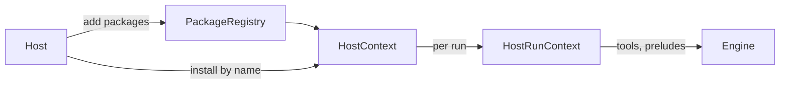

# Install Plugins by name from a package registry, with three Plugin kinds

### Context for a fresh reader

- Repository: `c:\Users\Vinnie\cursor\runvil` (git). Every path in this plan is relative to it.
- Baseline: commit `e7c376a04` ("Tidy up vibe/ plans"). Line numbers are from that commit, so search by name if they have moved.
- Terms defined in `AGENTS.md`:
  - The Engine runs prompts and performs no I/O itself.
  - The Harness steps the Engine and performs its effects.
  - The Host is the application (Workshop, or a command-line Host) that gives the Harness its model broker, timer, recorder, and installed Plugins.
  - A Plugin is a package of tools installed under a local name such as `web`, whose tools sit under that name (`web/fetch`).
- Terms this plan adds:
  - *package*: a Plugin crate's `Package` constant (a `vendor/name` name, prelude, needs, and `construct`), such as `plugin_web::PACKAGE`, named `runvil/web`.
  - *linked Plugin*: a `plugin-*` crate's package, which the Host adds to the registry.
  - *native Plugin*, or *the native*: `runvil/subagents`, built into every registry. Its future behavior and tools live in the Engine.
  - *the stub*: the native's Plugin object, which offers no tools and whose `call` is unreachable.
- Why the stub's `call` is unreachable: today a tool call travels in three hops.
  1. The Engine's scheduler issues an `Effect::ToolCall` (`crates/runvil-internal/engine/src/execute/scheduler/tool_call.rs`, lines 221-234).
  2. The Harness's effect loop performs it through `HostRunContext::call` (`crates/harness-internal/runner/src/effect_loop.rs`, lines 340-353).
  3. `HostRunContext::call` reaches a Plugin's `call` only for a tool id in that Plugin's own list (`crates/harness-internal/runner/src/host-run.rs`, lines 156-195).

  Calls the Engine answers itself never become effects, so they never reach the Harness. That includes today's task built-ins and the future subagent tools.
- Already in place and unchanged here:
  - the Lua `plugins` table and tool objects from `vibe/2026-10-09-5-author-api-reshape.md`: `plugins.required()`, `plugins.extras()`, `plugins.get(name)` with its `.tools`, `tools.required()`, `tools.extras()`, and `tools.offer`
  - the `tasks` Lua table, which the Engine installs in every prompt
- Plan record and commits:
  - When execution starts, copy this plan to `vibe/` as `2026-10-<dd>-<n>-package-registry.md`, using the next free number for that day. The latest plan record is `vibe/2026-10-10-3-prompt-reads-debt-removal.md`.
  - Mark each step `[completed]` in that copy as it lands.
  - Write each commit message by `c:\Users\Vinnie\cursor\.cursor\rules\commit.mdc`. Recent commits carry a one-line summary, a body, `Design:` lines, and a `Plan: vibe/<file>` trailer.
  - Close with a commit `Close plan: package-registry` carrying the same trailer.
  - Nothing is pushed.

<product-contract>

## Product Requirements

Hosts install Plugins by passing a compile-time `Package` constant, so nothing can list the available Plugins, install one by name, or pass it settings from a screen. This plan adds a `PackageRegistry` in the Harness that a Host builds once at startup, lists, and installs from by package-name string. It also names three Plugin kinds and builds `runvil/subagents` into every registry as the one Engine-native package, under a reserved name. `tasks` stays part of the language, in every prompt as it is today, and is not a Plugin. What `subagents` does is unchanged here.

- Problem and users:
  - Hosts (Workshop, a command-line Host) call `HostContext::install(package: Package, ...)` with a constant such as `plugin_web::PACKAGE`. No list exists for a user interface, and nothing can install by name.
  - `subagents`, the model-facing feature, needs to become a Plugin a Host installs or leaves out, under a name no other Plugin can take, so a Host can keep its tools out of a run.
  - `tasks` does not. It is a language feature, and a prompt that doesn't want it just doesn't use it.
- Goals:
  - A Host builds one registry, lists it (each package's name, description, needs, and kind), and installs by package name with a local name and a config value.
  - Three kinds: linked (built now), library (named only), and Engine-native (`subagents`).
  - A prompt declaring `subagents` passes preparation when the Host installed it, and is refused with `missing required Plugin: subagents` when not.
- Non-goals:
  - The subagent tools and everything `subagents` does.
  - Any change to the `tasks` table, which stays in every prompt.
  - Library Plugins, per-package config schemas, and the Workshop checkbox screen.
- Success criteria:
  - Workshop installs every Plugin by name, including the native.
  - `registry.list()` yields the native with `PluginKind::Native` and each added package with `PluginKind::Linked`, each with its description.
  - Each mistake fails with a named error:
    - `install` with an unknown name: `UnknownPackage`. This includes `runvil/tasks`, since `tasks` is not a package.
    - `install` misusing the native's name: `ReservedName`
    - `add` with a name already present, the native's name included: `DuplicatePackage`
    - `add` with a malformed name: `InvalidPackage`
  - Nothing in the run snapshot (`host-run.rs`) changes, and nothing about `tasks` changes.
  - Every exit gate passes.
- Constraints:
  - Engine crates don't depend on `runvil-plugin`, and Harness crates name only `runvil`, `runvil-plugin`, and `workspace-hack` outside their family. So the registry lives in the runner, and the Engine learns nothing about the native in this plan.
  - Every `.rs` file stays under 500 lines, and source directories stay flat. `host.rs` already has its two siblings (`host-run.rs`, `host-tests.rs` at 388 lines), so the registry is its own module.
  - Plugin docs say installed, snapshotted, or declared, never activated.
  - `unwrap_used` and `expect_used` are denied outside tests, and `missing_debug_implementations` warns, which is fatal under the gate.
- Open questions: none.

## Functional Specification

```rust
let mut packages = PackageRegistry::new();      // runvil/subagents is built in
packages.add(plugin_web::PACKAGE)?;             // linked packages, typed
for (package, kind) in packages.list() { /* package.name, package.description, package.needs */ }
let mut host = HostContext::new(packages, services);
host.install("runvil/web", None, Value::Null)?;
host.install("runvil/subagents", None, Value::Null)?;
```

- Registry:
  - `new()` (and `Default`) holds `runvil/subagents` as `PluginKind::Native`.
  - `add` refuses a name that isn't a valid `vendor/name` pair (`InvalidPackage`) and a name already present (`DuplicatePackage`). The native is present from the start, so `add` also refuses its name.
  - `list()` yields `(&Package, PluginKind)` in package-name order.
- Install:
  - Looks the name up in the registry, and fails with `UnknownPackage` when it isn't there.
  - With `name: None`, a package takes its name's second segment, as today. For the native, that's `subagents`.
  - `ReservedName` covers the native package under any other local name, and a linked package whose local name, given or default, is `subagents`.
  - Today's `NameTaken` twin rule is unchanged, so installing the native twice is `NameTaken`. One package may be installed many times (MCP once per server).
- The native's `construct` builds a Plugin with no tools, no prelude, and no needs. So install, the readiness wait, and the run snapshot treat it like any other Plugin:
  - A declared `subagents` that is installed is usable and meets its requirement.
  - A declared `subagents` that isn't installed is reported missing.
  - Neither adds a catalog tool or a prelude.
- `tasks` is not in the registry, and it isn't a reserved Plugin name. The `tasks` Lua table stays in every prompt, and its global name stays in `RESERVED_NAMES`, as today.

</product-contract>

<implementation-contract>

## Technical Design

The registry and installation live in the Harness runner. The Engine sees only what it does today: the catalog, the preludes, and the requirements report. The native is an installed Plugin whose object, the stub, has an empty tool list. So nothing changes in `Installed`, `wait_ready`, `begin_run`, or anywhere in `host-run.rs`. One incidental change sits outside the registry and install: `HostContext`'s hand-written `Debug` must show the new field, because Clippy's pedantic `missing_fields_in_debug` lint, which the workspace denies, rejects a `debug_struct(...).finish()` that skips a field.



```rust
// crates/runvil-plugin/src/plugin.rs
pub struct Package { /* name, prelude, needs, construct */ pub description: &'static str } // "" from new()
impl Package { pub const fn description(self, description: &'static str) -> Package; }

// crates/harness-internal/runner/src/packages.rs (new), re-exported by harness::plugin
#[derive(Debug)]
pub struct PackageRegistry {
    // keyed by package name, so list() runs in name order; the value is the package, its kind,
    // and its default local name, parsed once by add (or by the native seeding)
    entries: BTreeMap<&'static str, (Package, PluginKind, PluginId)>,
}
impl Default for PackageRegistry { fn default() -> PackageRegistry; }     // holds the native
impl PackageRegistry {
    pub fn new() -> PackageRegistry;                                       // PackageRegistry::default()
    pub fn add(&mut self, package: Package) -> Result<(), InstallError>;  // InvalidPackage, DuplicatePackage
    pub fn list(&self) -> impl Iterator<Item = (&Package, PluginKind)>;  // name order
    pub(crate) fn entry(&self, package: &str) -> Option<(Package, PluginKind, &PluginId)>; // install's lookup
    pub(crate) fn reserves(&self, name: &PluginId) -> bool;               // true when a native entry's default local name is `name`
}
#[derive(Clone, Copy, Debug, PartialEq, Eq)]
#[non_exhaustive]
pub enum PluginKind {
    Native,  // built into every registry; what it does lives in the Engine
    Linked,  // added by the Host with PackageRegistry::add
}            // Library { path } lands with dynamic loading

// private to packages.rs: the native, whose behavior lives in the Engine
const NATIVE: [Package; 1] = [Package::new("runvil/subagents", native)
    .description("Lets the model start, wait for, and cancel subagents")];
fn native(name: &PluginId, config: Value, services: &HostServices) -> Result<Arc<dyn Plugin>, ToolError>; // Ok(Arc::new(Native))
struct Native;                                                             // tools() is empty; call() returns an error; never gains tools

// crates/harness-internal/runner/src/host.rs
pub struct HostContext { packages: PackageRegistry, services: HostServices, installed: Vec<Installed> }
impl HostContext {
    pub fn new(packages: PackageRegistry, services: HostServices) -> HostContext; // was new(services)
    pub fn install(&mut self, package: &str, name: Option<PluginId>, config: Value) -> Result<PluginId, InstallError>;
}
#[derive(Debug, Clone, PartialEq, Eq, thiserror::Error)]                   // unchanged derives
#[non_exhaustive]
pub enum InstallError {
    #[error("Plugin package name `{package}` is not a vendor/name pair")]  // unchanged text; now returned by add
    InvalidPackage { package: &'static str },
    #[error("Plugin package `{package}` is already in the registry")]      // add
    DuplicatePackage { package: &'static str },
    #[error("Plugin package `{package}` is not in the registry; add it with PackageRegistry::add before installing it")] // install
    UnknownPackage { package: String },
    #[error("Plugin package `{package}` cannot be installed as {name}: a native Plugin keeps its own name, and no other package may take it")] // install
    ReservedName { package: &'static str, name: PluginId },
    NameTaken { name: PluginId, existing: PluginId },                      // unchanged, text included
}
```

`entry` returns a tuple rather than a private struct, so the `private_interfaces` lint has nothing to flag. `Package` is `Copy`, so `install` takes it by value. The error texts are suggestions in the house style: they name what was asked for and what is wrong.

`NATIVE` stays an array of one, so the registry seeds it and the guard test loops over it the same way they would for a second native.

Paths are relative to the `runvil` repository. Line numbers are as of `e7c376a04`.

- Step 1, package descriptions:
  - [crates/runvil-plugin/src/plugin.rs](crates/runvil-plugin/src/plugin.rs):
    - add the `description` field on `Package` (lines 114-142), set to `""` in `new` (lines 152-166)
    - add the `description` builder beside `prelude` and `needs`
    - show it in `Debug`, and add `.description(...)` to the `text` example in the doc comment (lines 107-111)
  - Descriptions on `plugin_web::PACKAGE` ([web.rs](crates/plugin-web/src/web.rs) line 29), `plugin_user_input::PACKAGE` ([lib.rs](crates/plugin-user-input/src/lib.rs) line 84), and `plugin_mcp::PACKAGE` ([lib.rs](crates/plugin-mcp/src/lib.rs) line 88). Suggested text: "Search the web and fetch pages", "Ask the person running the prompt", and "Tools from one MCP server".
- Step 2, the registry and string installs:
  - New `crates/harness-internal/runner/src/packages.rs` holds:
    - the registry, `PluginKind`, and the private `NATIVE` constant, each public item with a doc comment (`missing_docs`)
    - `native`, which builds `Arc::new(Native)` and carries the `#[expect(clippy::needless_pass_by_value, clippy::unnecessary_wraps, reason = ...)]` that `host-tests.rs`'s `listed` (lines 52-57) carries for the same fixed `construct` signature
    - `Native`, whose `tools()` returns an empty `Vec`. Its `call` returns `ToolError::message`, naming `cx.tool()` and saying the Engine answers a native Plugin's calls.
    - `package_name` (the `vendor/name` check, also returning the default local name), which moves here from `host.rs` (lines 229-235) and becomes `pub(crate)`. `normalize` (lines 237-245) stays in `host.rs` for the `NameTaken` check.
    - a test sibling, `packages-tests.rs`, wired with `#[cfg(test)] #[path = "packages-tests.rs"] mod tests;`
  - The constraint comment sits on `NATIVE`, and `Native` and `native` point to it. It is the one comment this plan adds, and it states what the code can't show:
    - A built-in's behavior and tools live in the Engine.
    - This Plugin exists only so install, readiness, and the run snapshot treat a built-in like any other Plugin.
    - It must never offer tools, carry a prelude, or need services.
    - Its `call` is unreachable, because the run snapshot routes a call only to a tool in a Plugin's own list.
  - Registry behavior:
    - `Default` seeds each `NATIVE` entry through `package_name`, inserting it as `PluginKind::Native` with its default local name. `expect` is denied, so a name that failed to parse would be skipped, not unwrapped. The integration test that lists `runvil/subagents` pins that it parses.
    - `new` returns `PackageRegistry::default()`. Clippy's `new_without_default` requires the `Default` impl.
    - `add` runs three checks in order:
      1. Parse the name with `package_name`, or fail with `InvalidPackage { package: package.name }`.
      2. Refuse a name already present with `DuplicatePackage { package: package.name }`. This also covers the native's name.
      3. Insert the package as `PluginKind::Linked` with its default local name.
    - `list` is `self.entries.values().map(|(package, kind, _)| (package, *kind))`. Edition 2024 captures the borrow of `self`, so the return type needs no `+ '_`.
    - `entry` is a lookup in `entries`, and `reserves` is true when any `PluginKind::Native` entry's default local name equals `name`. `PluginId` is lowercase-only, so plain equality is exact.
  - [host.rs](crates/harness-internal/runner/src/host.rs):
    - `HostContext` (lines 42-45) gains `packages: PackageRegistry`, and `new` (lines 55-67) takes it.
    - `install` (lines 69-119) runs these steps in order:
      1. Look the name up with `self.packages.entry(package)`, or fail with `UnknownPackage { package: package.to_owned() }`.
      2. Take the local name as `name.unwrap_or_else(|| default.clone())`.
      3. A `PluginKind::Native` entry whose local name differs from its default fails with `ReservedName { package: package.name, name }`.
      4. A `PluginKind::Linked` entry whose local name `self.packages.reserves(...)` fails the same way.
      5. Today's `NameTaken` twin check, `construct` call, and push follow, unchanged. So installing the native twice is `NameTaken`.

      Today's `package_name(...).ok_or(InvalidPackage)` at the top of `install` goes, because `add` already validated the name.
    - `Debug` (lines 184-197) adds `.field("packages", &self.packages)` before `.finish()`.
    - `InstallError` (lines 199-227) gains the three variants above. Its doc comment becomes "A mistake `PackageRegistry::add` or `HostContext::install` refuses outright, so the Host's author sees it at startup", with the construct-failure paragraph kept. Each new variant documents its fields.
    - The module doc (lines 1-15) says the context is built once at startup over a [`PackageRegistry`], and that a Host installs a package by the name the registry holds, under a local name. The rest of the doc (construct runs once, the readiness wait, the per-run snapshot) stays. The `new` and `install` docs say the same: `new` takes the registry, and `install`'s `# Errors` lists `UnknownPackage`, `ReservedName`, and `NameTaken`.
  - [runner lib.rs](crates/harness-internal/runner/src/lib.rs):
    - Declare `mod packages;`, and re-export `PackageRegistry` and `PluginKind` beside the line-42 `pub use host::{HostContext, InstallError};`.
    - Add a bullet to the crate doc's `## Invariants` (lines 13-25), which Harness crates must carry: a Host installs a Plugin only by a package name its `PackageRegistry` holds. The registry holds the native `runvil/subagents` from the start and refuses a duplicate name, and install refuses the native's local name to every other package. So no other Plugin can take `subagents`.
  - [crates/harness/src/lib.rs](crates/harness/src/lib.rs):
    - Re-export `PackageRegistry` and `PluginKind` in `pub mod plugin` (lines 25-34).
    - The crate doc's first sentence (lines 3-4) becomes: a Host adds its Plugin packages to a [`plugin::PackageRegistry`], builds one [`plugin::HostContext`] over it, and installs Plugins by package name.
    - The `plugin` module doc (lines 26-28) adds "the registry a Host lists and installs packages from".
  - [crates/workshop/server/src/agents.rs](crates/workshop/server/src/agents.rs), `with_plugins` (lines 140-179):
    - Build `PackageRegistry::new()`, add the web, user-input, and mcp constants (warning on error), and build `HostContext::new(packages, services)`.
    - Install `plugin_web::PACKAGE.name`, `plugin_user_input::PACKAGE.name`, `"runvil/subagents"`, and `plugin_mcp::PACKAGE.name` per server.
    - Its signature stays, so the callers in `agents/tests.rs` don't change.
    - Name the local `packages`, since `registry` there is the gateway `workshop_registry::Registry`.
    - The install order stays web, then user-input (whose returned name still builds the ask tool id), then the native, then each MCP server. A refused native install is logged with `tracing::warn!`, like the others, and the server still starts.
    - The doc comment (lines 140-148) names the native among the installed Plugins, and so does the module doc (lines 12-14): "the server's `HostContext` with web, user-input, the native subagents, and the MCP servers of the configured `mcp.json` installed".
  - [crates/harness/examples/run-prompt.rs](crates/harness/examples/run-prompt.rs) line 72: `HostContext::new(PackageRegistry::new(), HostServices::new())`.
  - Test call sites. A test now adds each package to a registry before it builds the context, then installs by `package.name`. Paths are under `crates/`, with `runner` meaning `harness-internal/runner`.
    - `runner/src/host-tests.rs`: `host()` (line 105) becomes `host(packages: &[Package]) -> HostContext`, and a sibling `host_with(services, packages)` serves the tests that build with Host-wide services, such as `provided` around line 213. Each test passes the packages it installs.
    - `runner/tests/it/support.rs` (the shared helpers) gains `pub(crate) fn registry(packages: &[Package]) -> PackageRegistry`. It adds each package to `PackageRegistry::new()`, with `unwrap`, which tests allow. Every runner integration test builds its context as `HostContext::new(registry(&[...]), services)`.
    - `runner/tests/it/prepare.rs`:
      - `bare()` (line 90) becomes `HostContext::new(registry(&[]), HostServices::new())`. Its seven callers in `prepare.rs`, `prepare-files.rs`, and `prepare-ready.rs` don't change.
      - `installing(package)` (line 95) builds over `registry(&[package])` and installs `package.name`.
    - `runner/tests/it/prepare-prelude.rs` (line 81) builds over `registry(&[...])` of the echo packages it installs.
    - `runner/tests/it/prepare-ready.rs` (line 146) builds `HostContext::new(registry(&[SLOW]), wide)`, keeping its Host-wide services, then installs `SLOW.name` under several local names (line 148).
    - `runner/tests/it/scripted.rs`:
      - `host_holding` (line 260) builds over `registry(&[HOLD, ASKER])`. That way `with_asker` (line 270), which installs `ASKER.name` into a context someone else built, works on every `hold_host` and `surviving_hold_host` result used by `harness-stop.rs`.
      - `host_holding` installs `HOLD.name` (line 264).
    - `runner/tests/it/harness-stop-timing.rs` (line 67) builds `HostContext::new(registry(&[ASKER]), HostServices::new())` before `with_asker`.
    - `runner/tests/it/{harness,harness-errors}.rs` change only where they call `HostContext::new`: pass `registry(&[...])` of what they install, or `PackageRegistry::new()`.
    - `harness/tests/suite/{host,launch,broker}.rs` only call `HostContext::new`: pass `PackageRegistry::new()`. `harness/tests/suite/asker.rs` adds `ASKER`, then installs `ASKER.name` (line 44).
    - `workshop/agents/tests/it/support.rs` (line 63) and `workshop/agents/src/input-tests.rs` (line 270): add `plugin_user_input::PACKAGE`, then install `plugin_user_input::PACKAGE.name`.
  - Docs:
    - [AGENTS.md](AGENTS.md) line 12, the whole Plugin definition, becomes the following. It keeps today's last three sentences word for word, and it must pass the docs-claims scan: Plugin capitalized, and installed, snapshotted, or declared, never activated.

      > **Plugin**: a package of tools a Host adds to its package registry and installs into a `HostContext` by package name, such as `runvil/web`, under a local name the Host chooses, such as `web`. Every tool it offers sits under that name (`web/fetch`). A Plugin is linked (a `plugin-*` crate implementing `runvil-plugin`), library (loaded from a dynamic library; not built yet), or Engine-native (`runvil/subagents`, implemented in the Engine under the fixed name `subagents`, which no other Plugin may take). Linked and library Plugins use only the `runvil-plugin` API. Every run receives every usable Plugin's tools: those of each installed Plugin that built and whose per-run services the run has. Declaring a Plugin under `plugins:` in a prompt's frontmatter installs its Lua prelude and makes it required, and the prompt's Lua decides what the model sees. A Plugin has no other name: never capability, pack, or addon.
    - The `Package` doc in [crates/runvil-plugin/src/plugin.rs](crates/runvil-plugin/src/plugin.rs) (lines 102-103, "Passing it to the Harness's install is also what links the Plugin crate into the Host") becomes "Adding it to the Harness's package registry is also what links the Plugin crate into the Host." The field docs for `name` and `construct` stay accurate.
- Deferred to the `tasks` and `subagents` overhaul, which adds the subagent tools:
  - `subagents` is model-facing, so it behaves like a linked Plugin. When the Host installs it, its tools are in every run: in `tools.required()` when the prompt declares `subagents`, in `tools.extras()` when it doesn't, and the prompt's Lua offers them with `tools.offer`. When the Host doesn't install it, no run has them.
  - So each run must tell the Engine which natives the Host installed. How it does that is the overhaul's decision. The Engine still answers the calls in its scheduler, so they never become effects.
  - The overhaul also removes `tools.allow_tasks` and today's four model built-ins (`task`, `task_cancel`, `task_status`, `await_tasks`), so this plan doesn't gate them on the install.

</implementation-contract>

<verification-contract>

## Testing Plan

- Unit, in the new `crates/harness-internal/runner/src/packages-tests.rs`: `natives_offer_no_tools_prelude_or_needs` loops over every entry in `NATIVE`. Each one's `construct`, called with the default local name `super::package_name` returns for it (`unwrap` is allowed in tests), `Value::Null`, and `HostServices::new()`, builds a Plugin whose `tools()` is empty, and the entry has no `prelude` and no `needs`. It loops over the constant, not one name, so a native added later is covered too. This is the guard that fails if anyone gives the stub tools.
- Integration, in a new `crates/harness-internal/runner/tests/it/packages.rs` with `mod packages;` in `main.rs` (beside `mod prepare;`). Everything it tests is public, and `host-tests.rs` (388 lines) has little room. Linked test packages come from `prepare.rs`'s existing `pub(crate) const fn echo_package(name, prelude)`, for example `echo_package("acme/web", None)`. A package with needs is built with `Package::new(...).needs(...)`, as `prepare-host-services.rs` does. The test names below are suggestions in the house style.
  - Registry:
    - `the_registry_lists_the_native_and_each_added_package_in_name_order`: `PackageRegistry::new().list()` yields exactly `runvil/subagents` with `PluginKind::Native` and a non-empty description. After `add(echo_package("acme/web", None))`, it yields `acme/web` (`PluginKind::Linked`) before `runvil/subagents`. A package added with needs lists those needs.
    - `add_refuses_a_duplicate_package_including_the_native`: a second `acme/web` and a package named `runvil/subagents` are both `DuplicatePackage`.
    - `add_refuses_a_package_name_that_is_not_a_vendor_name_pair`: the six names of today's install test at `host-tests.rs` lines 142-158 (`web`, `acme/web/extra`, `/web`, `acme/`, `Acme/web`, `acme/Web`) are each `InvalidPackage`. That install test is deleted, because `install` no longer parses names.
  - Install:
    - `install_refuses_a_package_the_registry_does_not_hold`: `acme/missing` is `UnknownPackage`, and so is `runvil/tasks`, which pins that `tasks` is not a package.
    - `no_other_package_can_take_the_native_name`: `acme/subagents` with no name, and `acme/web` named `subagents`, are `ReservedName`, and so is `runvil/subagents` named `other`. The test also checks the `ReservedName` message text once.
    - `the_native_installs_once_under_its_own_name`: `runvil/subagents` with no name returns `subagents`, and a second install is `NameTaken`.
- Unit, in `host-tests.rs`, using its existing `prompt()` and `catalog_ids` helpers and `begin_run`:
  - `a_declared_native_is_met_when_installed_and_missing_when_not`: with `runvil/subagents` installed, a prompt with `plugins:\n  - subagents\n` reports no missing requirement. Without that install, `requirements.missing_required` holds `subagents`.
  - `an_installed_native_adds_no_catalog_tool_and_no_prelude`: `catalog_ids` is unchanged by installing the native, and `run.preludes(&prompt)` is empty for a prompt declaring `subagents`.

  The existing tests switch to `host(packages)` and `host_with(services, packages)` as described under Step 2.
- Workshop, in `crates/workshop/server/src/agents/tests.rs`: `a_prompt_declaring_subagents_prepares_on_the_servers_installed_plugins` mirrors `a_prompt_declaring_web_prepares_on_the_servers_installed_plugins` (lines 127-137). It builds `host_context(&Registry::new(), None)`, then expects `run_prompt(&Arc::new(host), requiring("subagents"))` to return `Some(RunOutcome::Completed { final_text: "browsed".to_owned() })`. `requiring` (line 37) declares the Plugin and returns `'browsed'` without calling a tool, so it works for a Plugin with no tools. This also pins the literal native name in `with_plugins`.
- Regression: every existing install, snapshot, and preparation test passes through the registry helper, and every test that uses `tasks` passes unchanged.
- Exit criteria:
  - `cargo nextest run --locked --workspace --exclude workshop --exclude workshop-server --exclude workshop-server-api --all-features`, then `cargo nextest run --locked -p workshop -p workshop-server -p workshop-server-api`
  - both clippy runs with `CARGO_BUILD_WARNINGS=deny`
  - `cargo fmt --all --check`
  - `cargo doc --workspace --no-deps --all-features --exclude workshop --exclude workshop-server --exclude workshop-server-api` and `cargo doc -p runvil --no-deps`, both with `RUSTDOCFLAGS="-D warnings"`
  - `cargo +nightly-2026-09-05 xtask api --check`, which should pass unchanged, since the `runvil` facade doesn't change
  - `cargo test -p build-xtask`
  - `node --test crates/workshop/ui/test/docs-claims.mjs`

</verification-contract>

<decision-record>

## Decision Record

- Decisions:
  - The scope is the package registry and the Plugin kinds alone. User: "just the package registry and plugin kinds".
  - `tasks` is part of the language, not a Plugin, and `subagents` is the one Engine-native Plugin. Rationale: `tasks` became a Plugin when it was both Lua-facing and model-facing. A Host has a reason to keep the model-facing tools out of a run, but no one has a reason to make the `tasks` table optional. User: "tasks should not even be a plugin anymore it should just be a language feature. a prompt that doesn't want tasks... just doesn't use it." and "There is a use-case for not having the model-facing version in tools.required(). But there is no use-case for making the `tasks` table itself optional. and I think it creates more problems than it solves."
  - Making the Host's install of `subagents` control which runs get its tools waits for the `tasks` and `subagents` overhaul. Rationale: `subagents` is model-facing, so it must behave like a linked Plugin, not be switched on by the prompt's declaration. The overhaul removes `tools.allow_tasks` anyway. User: "We are going to overhaul `tasks` and `subagents` later anyway. so the tools.allow_tasks problem is going to just vanish" and "Fix it later."
  - Hosts install by package-name string through a registry. User: "it has to be strings, because there needs to be a way for a user interface to show a list of available packages, and then let the user check or uncheck the ones that they want".
  - Loading and installing are separate steps, every entry records its kind, and installing walks the Host's selection, not the registry. User: "How can it know the names up front?" and "how does it distinguish between the registry entries that came from the directory versus the ones that are built in?"
  - The registry is built once at startup and reused. User: "the workshop will build the registry once, when it launches and it'll use it over and over again".
  - There are three kinds, and only the native reaches Engine internals. User: "1 and 2 strictly follow the normalized plugin API and do not get special access to engine implementation, while 3 is the special one."
  - The native installs like any package, by string, and its name is reserved. User: "it needs to be impossible for another [...] plugin to take the name".
  - No separate crate for the native Plugin. User: "but we aren't creating a plugin-tasks crate are we?"
  - The registry lives in the Harness runner, and the Engine never sees it. Rationale: it holds `Package` values from `runvil-plugin`, which Engine crates may not depend on, and installing is already the Harness's job.
  - The API is compressed to what this plan's behavior reads, reusing existing structures. User: "see if there are any structures that can be reused instead of creating new ones. Preserve the functionality, see if you can compress the API."
- Defaults chosen in planning, open to override:
  - The native is a private `Package` constant in the runner, whose `construct` builds a Plugin with no tools. So install, readiness, and the snapshot treat it like any Plugin. Its behavior and tools will live in the Engine.
  - `list()` yields `(&Package, PluginKind)`, reusing `Package` for the name, description, and needs.
  - `add` and `install` share `InstallError`. `InvalidPackage` moves from install to add unchanged, and the native's name is a plain `DuplicatePackage`.
  - `HostContext::new` takes the registry by value.
  - The kind enum is `PluginKind`, matching the AGENTS.md wording and leaving `harness::vfs::Origin` as the facade's only `Origin`.
  - `PluginKind` is `#[non_exhaustive]`, so `Library { path }` can land later.
  - `tasks` is not a reserved Plugin name. A Plugin installed as `tasks` would be its own namespace (`tasks/...` tools, `plugins.get('tasks')`), and preludes already can't take the `tasks` global. Reserving it would be code for a confusion no Host has hit.
  - Workshop installs the native by default: the linked packages by `PACKAGE.name`, and the native by its literal name, which its test pins.
  - Workshop keeps no separate registry handle until a user interface reads one.
- Rejected alternatives:
  - Keeping `tasks` as a native Plugin that the Host installs and a prompt declares. Reason: no use case for an optional `tasks` table, and gating it would add a declaration to about 50 test files and prompts for nothing.
  - A closed `NativePlugin` enum, with `Installed::Native` and `RunPlugin::Native` arms across install, readiness, snapshot, catalog, preludes, requirements, and offering, plus a `runvil` facade export and a `local_name()` with no infallible way to build a `PluginId`. Reason: special cases with no reader in this plan. How the Engine learns which natives are installed is decided by the `tasks` and `subagents` overhaul, which is the first reader.
  - A `PackageEntry` type with four getters. Reason: `Package` already carries the name, description, and needs.
  - A separate `RegistryError` with `InvalidPackage`, `DuplicatePackage`, and `NativePackage`. Reason: `InstallError` already holds `InvalidPackage`, and a seeded native name is just a duplicate.
  - Folding the registry into `HostContext`. Reason: the registry is loaded once and outlives each selection a Host installs, and later folder loads add entries to it.
  - `Arc<PackageRegistry>` in `HostContext::new`. Reason: the context reads it only while installing. A `Clone` can come when a Host first builds a second selection.
  - Keeping `install(package: Package)` beside a registry lookup. Reason: anyone can build a `Package` named `runvil/subagents`. Resolving names only through the registry is what keeps the native's name unforgeable.
  - A Host-side method or run option to switch `subagents` on; installing by constant, or by string for the native only; installing a library by file path; listing libraries from a manifest, lazy activation, or scanning them in a separate process.
- Risks:
  - String installs move a typo from compile time to startup. Typed `add`, the Workshop test, and named errors limit it.
  - The native is installable before it does anything, so a prompt declaring `subagents` prepares but gets nothing until the `subagents` behavior lands.
  - Until the overhaul, leaving the native out only refuses prompts that declare `subagents`. A prompt that calls `tools.allow_tasks()` still offers the model the four task built-ins without the Host's say. The overhaul removes `allow_tasks`.
  - The cost of making the native a tool-less Plugin is confined to future code changes, by a person or an LLM. At runtime it costs nothing:
    - `Plugin::call` has one call site (`host-run.rs` line 193), reached only for a tool in the Plugin's list, so the stub's `call` never runs.
    - Only the registry can hold the native's name, so it can't be forged.
    - Run records hold no Plugin list.
    - The overhead is one empty object.

    Two mistakes remain possible:
    - New code that walks the installed Plugins treats the native as a Plugin with no tools without the compiler asking. That is usually right, and wrong only silently.
    - Someone hangs native behavior on the stub in the Harness by giving it tools and a real `call`. This is the worst plausible damage: it breaks the rule that the native is implemented in the Engine, and it would send model calls out as outside-world requests, which breaks replay, because a recorded answer can't stand in for a subagent the Engine must start.

    The doc comment on `Native` warns the writer, and `natives_offer_no_tools_prelude_or_needs` fails the change. User: "the only cost is if a developer makes a mistake, and that developer could be an LLM."
- Deferred: library Plugins, per-package config schemas, the Workshop checkbox screen, and everything `subagents` does.

</decision-record>

<project-survey>

## Project Survey

- Status: complete
- Build command: `cargo build --locked -p gateway`.
  - The gateway is the workspace's only default member, so plain `cargo build` builds the same thing.
  - The desktop app builds with `cargo workshop`, an alias for `run -p build-workshop --`. It builds the gateway, stages it as the Tauri sidecar, builds `workshop`, and removes the sidecar.
  - The `gateway-config-ui` and `workshop-server` build scripts bundle their UIs with esbuild. They need Node.js 22 and one `npm ci --prefix crates/workshop` plus one `npm ci --prefix crates/gateway/config-ui/ui` per checkout. Both installs, Node.js, cargo-nextest, and the pinned nightly are present on this machine.
- Focused test command pattern: `cargo nextest run --locked -p <crate> --all-features <test-name-filter>`. Drop `--all-features` for `workshop`, `workshop-server`, and `workshop-server-api`, which CI never builds with all features.
- Component test command pattern: `cargo nextest run --locked -p <crate> --all-features`, with the same three exceptions. `cargo test -p build-xtask` runs the boundary and structural checks.
- Full-suite test command:
  - `cargo nextest run --locked --workspace --exclude workshop --exclude workshop-server --exclude workshop-server-api --all-features`, then `cargo nextest run --locked -p workshop -p workshop-server -p workshop-server-api`. The first run includes `build-xtask`.
  - CI also runs `cargo nextest run --locked -p workshop-server --features headless`, which serves without the UI bundle.
  - The wording and rulebook scan: `node --test crates/workshop/ui/test/docs-claims.mjs`. It needs no `npm ci` and runs from any directory.
  - The UI suites: `npm test --workspaces --if-present` in `crates/workshop` and `npm test` in `crates/gateway/config-ui/ui`.
- Linter command:
  - `cargo clippy --workspace --exclude workshop --exclude workshop-server --exclude workshop-server-api --all-targets --all-features` and `cargo clippy -p workshop -p workshop-server -p workshop-server-api --all-targets`, both with `CARGO_BUILD_WARNINGS=deny` (in PowerShell, `$env:CARGO_BUILD_WARNINGS='deny'`).
  - Never run a standalone `cargo check --workspace` beside them. The one exception is `cargo check -p gateway --no-default-features`, the headless build shape clippy does not cover.
  - UI type checks: `npm run typecheck --workspaces --if-present` in `crates/workshop` and `npm run typecheck` in `crates/gateway/config-ui/ui`.
  - Supply chain: `cargo deny check`, `cargo audit`, and `cargo hakari verify`.
- Formatter check command: `cargo fmt --all --check`, with `style_edition = "2024"`. The pre-commit hook runs it.
- Docs command:
  - `cargo doc --workspace --no-deps --all-features --exclude workshop --exclude workshop-server --exclude workshop-server-api`, `cargo doc -p runvil --no-deps`, `cargo doc -p harness --no-deps`, `cargo doc --locked --no-deps --all-features -p runvil-engine --document-private-items`, and `cargo doc --locked --no-deps -p workshop-server --document-private-items`, all with `RUSTDOCFLAGS="-D warnings"`. The facade docs build with default features on purpose.
  - The facade surface check: `cargo +nightly-2026-09-05 xtask api --check` against `crates/runvil/public-api.txt`, and `--bless` regenerates the listing. The nightly is pinned in `crates/build-xtask/src/api/toolchain.rs`. Its fixtures run with `cargo +nightly-2026-09-05 nextest run --locked -p build-xtask --run-ignored only`.
  - The documentation site: `cargo xtask site`, which needs `RUNVIL_DOCS` naming a `runvil-docs` checkout and an mdBook binary (`MDBOOK`, default `mdbook`).
- Test placement and naming conventions:
  - Unit tests sit in a sibling file wired with `#[cfg(test)] #[path = "<stem>-tests.rs"] mod tests;`. A module whose tests reach three files keeps them in a `tests/` subdirectory beside it, one file per topic, as in `crates/runvil-internal/engine/src/execute/tests/`. A few `build-*` crates, `gateway-api-types`, and `gateway-api-discovery` still hold inline `mod tests { }` blocks.
  - Integration tests compile as one binary per crate: from `tests/it/main.rs` in most crates, and from `tests/suite/main.rs` in `harness` and `runvil`. Each topic is one module file, and shared helpers go in `support.rs` or a `support/` directory.
  - A few crates keep standalone test files directly in `tests/`: `gateway-stt-engine`, `gateway-stt-backend-whisper`, `gateway-cloud-providers`, and `build-workshop`.
  - Test names are snake_case sentences stating the behavior, such as `a_call_without_the_per_run_service_it_needs_fails`.
  - Doctests are banned. `build-xtask`'s `no_doctests` check fails any doc comment holding a code block rustdoc would compile, so examples use `text`, `json`, or `toml` fences.
  - Nightly-only `build-xtask` fixtures and the native whisper tests are `#[ignore]`d. `.config/nextest.toml` puts the STT crates in a `heavy` test group.
- Directory map:
  - `crates/`: all 52 crates. The top level holds the public and shared layer: the `runvil` facade, `runvil-plugin`, `harness`, `harness-gateway-client`, `gateway-api-types`, `gateway-api-discovery`, the `plugin-*` crates (`plugin-web`, `plugin-user-input`, `plugin-mcp`), `shared-error-source`, `shared-loopback`, the `build-*` tooling, and `workspace-hack`.
  - `crates/runvil-internal/`: the Engine's private crates `types`, `engine`, `lua`, `parser`, `vfs`, and `model-client`.
  - `crates/harness-internal/runner`: the Harness's private per-run runner and effect loop.
  - `crates/gateway/`: the gateway's private crates `app`, `cloud-providers`, `config`, `config-ui`, `local`, `logging`, `progress`, `protocol`, `routing`, and `web-search`, plus the `stt/` subsystem (`api`, `engine`, `backend-whisper`, `whisper-ffi`).
  - `crates/workshop/`: Workshop's crates `desktop` (package `workshop`), `server`, `server-api`, `agents`, `gateway`, `menu`, `protocol`, `registry`, `run-log`, `status`, `support`, `user-state`, and `workspace`, plus the npm workspace packages `ui`, `look`, and `platform`.
  - `crates/shared-ui`: a TypeScript and CSS package the gateway config UI consumes, not a Rust crate.
  - `guide/`: mdBook `book.toml` files for the gateway, language, and Workshop books, the shared page chrome, and the landing page style. The chapters live in the separate `runvil-docs` checkout.
  - `prompts/`: example prompt files. `images/`: README art.
  - `tools/`: Node scripts for staging the gateway sidecar and a live TTS check, each with a `.test.mjs`.
  - `vibe/`: plan records, recent ones at the top level and older ones filed by month.
  - `.github/workflows/`: `ci.yml` plus release, nightly, site, and native-library workflows. `ci-green` is the single required check.
  - `.config/`: `nextest.toml` and `hakari.toml`. `.cargo/config.toml`: the `xtask` and `workshop` aliases and the Windows `rust-lld` linker with the static CRT. `.githooks/`: pre-commit (format) and pre-push (wording scan, headless check, clippy, deny), with `core.hooksPath` set to it. `.cursor/rules/`: the Workshop architecture and SPA rules.
  - Untracked: `local/` (operator config, profiles, and fixtures), `cabinet/`, `target/`, and `target-msrv/`.
- Component boundaries, which `cargo test -p build-xtask` enforces across normal, dev, and build dependencies:
  - The Engine (`runvil*`) depends on no gateway, Workshop, Harness, or Plugin crate. Outside crates reach it only through `runvil` and `runvil-plugin`, the only two crates that may enter `runvil-internal/`.
  - The Harness (`harness*`) names only `runvil`, `runvil-plugin`, and `workspace-hack` outside its family, and no shared or `build-*` crate. The exception is `harness-gateway-client`, which depends on `plugin-web` to implement its `SearchProvider`. Outside crates reach the Harness only through `harness` and `harness-gateway-client`, and only `harness` may enter `harness-internal/`. The chain runs `harness-gateway-client` on `harness`, `harness` on `harness-runner`, and `harness-runner` on `runvil` and `runvil-plugin`.
  - Plugin crates depend only on `runvil-plugin`, `shared-*` crates, `workspace-hack`, and outside libraries. No Engine, gateway, or Harness crate except `harness-gateway-client` names a Plugin crate. Today `workshop-server` and `workshop-agents` are the other dependents.
  - The gateway (`gateway*`) depends on no Engine, Workshop, Harness, or Plugin crate. Outside crates reach it only through `gateway-api-types` and `gateway-api-discovery`. Inside the family, only `gateway-stt` is visible outside `gateway/stt/`.
  - Workshop is a Host. It reaches the gateway only through that public pair, the Engine only through `runvil` and `runvil-plugin`, and the Harness only through `harness` and `harness-gateway-client`. Its tiers depend one way: the server on features (`agents`, `workspace`, `user-state`, `run-log`), features on services (`menu`, `gateway`, `status`), and services on vocabulary (`protocol`, `registry`, `support`). Same-tier crates meet only through `workshop-protocol` wire types and `workshop-registry` slots. The desktop app names only `workshop-server-api`, which names only `workshop-server`.
  - `shared-*` crates depend on no product crate. `build-*` crates are tooling and may depend into any container.
- Conventions summary:
  - Engine, Harness, Host, and Plugin are capitalized with one meaning each. Engine crates say "the caller" and never mention the Host. `docs-claims.mjs` enforces what a scan can see.
  - Every crate's build script calls `build_ceiling::check()`, which fails any Rust file over 500 lines. Splits go into private child modules without widening visibility.
  - Clippy `all` and `pedantic` deny, `unwrap_used` and `expect_used` deny outside tests, and `allow_attributes` deny, so suppressions use `#[expect(..., reason = "...")]`. `missing_docs`, `missing_debug_implementations`, and `unreachable_pub` warn, which is fatal under the gate. `unsafe_code` is denied outside its owned boundaries, and `clippy.toml` bans process-global installers outside binary entry points.
  - Every `workshop-*` `lib.rs` opens with a `//!` doc carrying a `## Invariants` marker naming its tier and allowed dependencies, and `lib.rs` holds only docs, attributes, `mod` declarations, and re-exports.
  - Source directories stay flat until a group reaches three files. Below that, kebab siblings such as `foo-bar.rs` are wired with `#[path]`.
  - Comments explain only non-obvious constraints, and every workaround cites its upstream issue URL.
  - Error messages are written for a model to read: concise, naming what was required and what was found.
  - Behavior changes ship with tests in the same change. A Cargo feature gates only a real build constraint, never product shape.
  - JSON that reaches a recorder round-trips exactly, with sorted keys and finite numbers.
  - Workspace dependencies are declared once in the root `Cargo.toml`, with a comment on every non-obvious pin. Every member inherits `workspace-hack`, which `cargo hakari` manages.
  - Commits carry a one-line summary, a body, optional `Design:` lines, and a `Plan: vibe/<file>` trailer.

</project-survey>

<execution-plan>

## Execution Instructions

<step-1>

### Step 1: Describe each Plugin package [completed]

- Component: `none`
- Work item: `descriptions`, detailed in the Technical Design's Step 1 list. Additive only: nothing reads `Package::description` yet, and the field is public, so it raises no dead-code warning. The `runvil` facade does not list `Package`, so `crates/runvil/public-api.txt` stays unchanged.
- `crates/runvil-plugin/src/plugin.rs`:
  - `Package` gains `pub description: &'static str`, which `Package::new` sets to `""`.
  - `Package::description(self, description: &'static str) -> Package`, a `const fn` builder beside `prelude` and `needs`.
  - `Package`'s `Debug` shows the new field, and the doc comment's `text` example adds `.description(...)`.
- Descriptions, using the Technical Design's suggested text:
  - `plugin_web::PACKAGE` in `crates/plugin-web/src/web.rs`
  - `plugin_user_input::PACKAGE` in `crates/plugin-user-input/src/lib.rs`
  - `plugin_mcp::PACKAGE` in `crates/plugin-mcp/src/lib.rs`
- Tests: none new. The existing `runvil-plugin` and Plugin crate tests pass.
- Verify:
  - `cargo nextest run --locked -p runvil-plugin -p plugin-web -p plugin-user-input -p plugin-mcp --all-features`
  - the Project Survey's first clippy run, with `CARGO_BUILD_WARNINGS=deny`
  - `cargo fmt --all --check`
- Commit: one `runvil` commit, `Describe each Plugin package`.

</step-1>

<step-2>

### Step 2: Install Plugins by name from a package registry [completed]

- Component: `none`
- Work items: `registry`, `install`, `callers`, `docs`, and `verify`. They land together, because changing `HostContext::new` and `install` breaks every caller at once. The Technical Design's Step 2 list holds the details for each artifact below.
- New `crates/harness-internal/runner/src/packages.rs`:
  - `pub struct PackageRegistry` over `BTreeMap<&'static str, (Package, PluginKind, PluginId)>`, with `Default` (seeds each `NATIVE` entry through `package_name`, skipping one that fails to parse because `expect` is denied), `new`, `add`, `list`, and the `pub(crate)` `entry` and `reserves`
  - `#[non_exhaustive] pub enum PluginKind { Native, Linked }`
  - the private `const NATIVE: [Package; 1]` for `runvil/subagents`, carrying the plan's one constraint comment; the `native` construct function with its `#[expect(...)]`; and the private `struct Native`, whose `tools()` is empty and whose `call` returns `ToolError::message`
  - `pub(crate) fn package_name`, moved from `host.rs`
  - the `packages-tests.rs` sibling, wired with `#[cfg(test)] #[path = "packages-tests.rs"] mod tests;`
- `crates/harness-internal/runner/src/host.rs`:
  - `HostContext` gains `packages: PackageRegistry`. `HostContext::new(packages, services)` takes it by value, and `install(&mut self, package: &str, name: Option<PluginId>, config: Value)` resolves through `self.packages.entry` in the Technical Design's five-step order, ending in today's unchanged `NameTaken` check, `construct` call, and push.
  - `InstallError` gains `DuplicatePackage`, `UnknownPackage`, and `ReservedName`. `InvalidPackage` keeps its text and is now returned only by `add`.
  - The hand-written `Debug` adds `.field("packages", &self.packages)`. `normalize` stays here.
  - The module, `new`, `install`, and `InstallError` docs change as the Technical Design says.
- Re-exports and crate docs:
  - `crates/harness-internal/runner/src/lib.rs`: `mod packages;`, `pub use packages::{PackageRegistry, PluginKind};` beside the `host` re-export, and the new `## Invariants` bullet
  - `crates/harness/src/lib.rs`: `PackageRegistry` and `PluginKind` in `pub mod plugin`, the crate doc's first sentence, and the `plugin` module doc
- Hosts:
  - `crates/workshop/server/src/agents.rs` `with_plugins`: builds a local `packages` registry from the web, user-input, and mcp constants, then installs web, user-input, `"runvil/subagents"`, and each MCP server by name, in that order, logging each refusal with `tracing::warn!`. Its signature stays. Its doc comment and the module doc name the native.
  - `crates/harness/examples/run-prompt.rs`: `HostContext::new(PackageRegistry::new(), HostServices::new())`
- Test call sites. Each builds its context over a registry of the packages it installs, then installs by `package.name`. Paths are under `crates/`:
  - `harness-internal/runner/src/host-tests.rs`: `host(packages: &[Package])` and `host_with(services, packages)`, which every existing test switches to. Delete the install-time invalid-name test (lines 142-158); its six names move to the `add` test below.
  - `harness-internal/runner/tests/it/support.rs`: `pub(crate) fn registry(packages: &[Package]) -> PackageRegistry`
  - `harness-internal/runner/tests/it/prepare.rs`: `bare()` over `registry(&[])`, and `installing(package)` over `registry(&[package])`. The extras test near line 382 installs `echo_package("tests/extra", None)` into an `installing(TOOLS)` context, so it builds its own context over `registry(&[TOOLS, echo_package("tests/extra", None)])` and installs both by name.
  - `harness-internal/runner/tests/it/prepare-prelude.rs` (line 81): replace `bare()` with a context over `registry(&[...])` of the `tests/first` and `tests/second` echo packages
  - `harness-internal/runner/tests/it/prepare-ready.rs` (line 146): `HostContext::new(registry(&[SLOW]), wide)`, installing `SLOW.name`
  - `harness-internal/runner/tests/it/scripted.rs`: `host_holding` over `registry(&[HOLD, ASKER])`, installing `HOLD.name`. `with_asker` installs `ASKER.name`.
  - `harness-internal/runner/tests/it/harness-stop-timing.rs`: line 67 over `registry(&[ASKER])`, and line 141 over `PackageRegistry::new()`
  - `harness-internal/runner/tests/it/harness.rs` (line 66) and `harness-errors.rs` (line 49): `PackageRegistry::new()`
  - `harness/tests/suite/host.rs` (lines 158 and 268), `launch.rs` (line 29), and `broker.rs` (line 91): `PackageRegistry::new()`. `asker.rs` (line 43) adds `ASKER` to a `PackageRegistry::new()`, then installs `ASKER.name`.
  - `workshop/agents/tests/it/support.rs` (line 63) and `workshop/agents/src/input-tests.rs` (line 270): add `plugin_user_input::PACKAGE`, then install `plugin_user_input::PACKAGE.name`
- Docs:
  - `AGENTS.md` line 12: the Plugin definition becomes the Technical Design's quoted text, word for word.
  - `crates/runvil-plugin/src/plugin.rs`: the `Package` doc's linking sentence becomes "Adding it to the Harness's package registry is also what links the Plugin crate into the Host."
- Tests, named as in the Testing Plan:
  - `packages-tests.rs`: `natives_offer_no_tools_prelude_or_needs`, looping over `NATIVE`
  - new `crates/harness-internal/runner/tests/it/packages.rs`, declared with `mod packages;` beside `mod prepare;` in `main.rs`: the three registry tests and the three install tests, built from `echo_package`, which together cover every case below:
    - `PackageRegistry::new().list()` yields exactly `runvil/subagents` as `PluginKind::Native` with a non-empty description. After adding `acme/web`, it yields `acme/web` (`PluginKind::Linked`) before `runvil/subagents`. A package added with needs lists those needs.
    - `add`: a second `acme/web` and a package named `runvil/subagents` are both `DuplicatePackage`. The six names `web`, `acme/web/extra`, `/web`, `acme/`, `Acme/web`, and `acme/Web` are each `InvalidPackage`.
    - `install`: `acme/missing` and `runvil/tasks` are both `UnknownPackage`; the second pins that `tasks` is not a package.
    - `install`: `acme/subagents` with no name, `acme/web` named `subagents`, and `runvil/subagents` named `other` are each `ReservedName`, and the test checks the `ReservedName` message text once.
    - `install`: `runvil/subagents` with no name returns `subagents`, and a second install is `NameTaken`.
  - `host-tests.rs`: `a_declared_native_is_met_when_installed_and_missing_when_not` and `an_installed_native_adds_no_catalog_tool_and_no_prelude`
  - `crates/workshop/server/src/agents/tests.rs`: `a_prompt_declaring_subagents_prepares_on_the_servers_installed_plugins`
  - Every existing install, snapshot, preparation, and `tasks` test passes with only its call site changed.
- Verify, from the `runvil` root after this step's edits; fixes land in this step's commit:
  - every exit criterion in the Testing Plan
  - `rg -n "HostContext::new\(HostServices|HostContext::new\(services\)|HostContext::new\(wide\)" crates` prints nothing
  - `git diff --stat e7c376a04 -- crates/harness-internal/runner/src/host-run.rs crates/runvil-internal` prints nothing, so the run snapshot, the Engine, the `tasks` table, and `RESERVED_NAMES` are unchanged
- Commit: one `runvil` commit, `Install Plugins by name from a package registry`.

</step-2>

</execution-plan>
