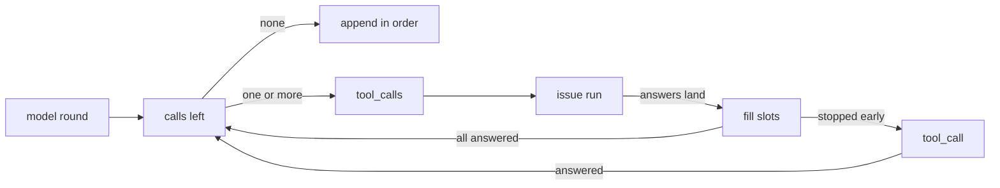

# Parallel tool calls and tasks.fanout

### Context for a fresh reader

- Repository: `c:\Users\Vinnie\cursor\runvil` (git). Paths are relative to it unless they start with `../`.
- Baseline: commit `e62bd6d77` (Close plan: native-docs-debt-removal). Every line number and count here was verified at that commit; search by name if they have moved.
- Shell: PowerShell on Windows. Set an environment variable for one command with `$env:NAME='value'; <command>`.
- Terms from `AGENTS.md`: the Engine runs prompts and performs no I/O; the Harness steps it and performs its effects; a Plugin is a package of tools installed under a local name.
- Terms used here:
  - *round*: one model reply inside `models.loop`. A reply may ask for several tool calls, today run one after another.
  - *catalog call*: a model call to a Plugin tool, which the Engine issues as an `Effect::ToolCall` for the Harness to perform.
  - *local call*: a model call to a local Lua tool (`tools.offer_local`), answered in the chain's own coroutine by a Lua handler.
  - *task built-ins*: `task`, `task_cancel`, `task_status`, and `await_tasks`, which the Engine answers itself after a section calls `tools.allow_tasks`.
  - *batch*: the leading catalog calls of a round's unanswered calls, issued together, even when there is only one.
  - *wire name*: a tool id with `/` and `.` replaced by `_`; the model sees only wire names.
- This plan is Parts 1 and 2 of the subagents plan (`C:\Users\Vinnie\.cursor\plans\section()_lua_global_49057d1f.plan.md`), landed on their own. That plan still describes both parts in its own words, and where the two differ, this plan wins. Its later `subagents` part builds on the batch here and deletes the four built-ins. Nothing in this plan needs that plan's text.
- Plan record and commits:
  - When execution starts, copy this plan to `vibe/` as `2026-10-<dd>-<n>-parallel-tool-calls.md`, using the next free number for that day (the latest record is `vibe/2026-10-11-2-native-docs-debt-removal.md`). Mark each step `[completed]` in that copy as it lands.
  - Each commit message has a one-line summary, a body, `Design:` lines, and a `Plan: vibe/<file>` trailer.
  - Close with a commit `Close plan: parallel-tool-calls` with the same trailer. Nothing is pushed.

<product-contract>

## Product Requirements

This plan runs a round's catalog calls in parallel and moves `fanout` to `tasks.fanout`. Every model catalog call takes the new batch path, even alone, so a call's route never depends on how many calls share its round. Local Lua tools and the task built-ins keep today's path, and the `fanout` global goes away with no compatibility stub. Success means two catalog calls in one round are issued in one Engine step and in flight at once, their records still append in call order, and everything else behaves as today.

- Problem and users:
  - A model that asks for several tool calls in one round waits for them one at a time, though the calls don't depend on each other. Hosted models commonly ask for several calls in one round; local models may not (see Assumptions, risks, and notes in the Decision Record).
  - Separately, the `fanout` helper is a bare global beside the `tasks` table, though it is built on the task protocol.
  - Both affect prompt authors: those whose `models.loop` rounds call Plugin tools, and those who call `fanout`.
- Goals:
  - Every model-issued catalog call goes through the batch path, alone or with others. When a round has two or more catalog calls in a row, they are in flight at once, and the round's records still append once, in call order.
  - Local calls and task built-ins run alone through today's path, unchanged.
  - `tasks.fanout(worker, collection)` replaces the `fanout` global. Every prompt has it, with no declaration, because `tasks` is part of the language.
- Non-goals:
  - Any change to what the four task built-ins do, or to `tools.allow_tasks`. The subagents plan reshapes and then deletes them.
  - Parallel local calls, and parallel script `tools.call`, which stay single calls.
  - Backward compatibility: the `fanout` global simply stops existing (`runvil: 0`). That value is the Engine major a prompt declares in its frontmatter (`crates/runvil-internal/parser/src/build-frontmatter.rs`); the waiver comes from the user's decision in the Decision Record, not from a written versioning rule.
- Success criteria:
  - Two catalog calls in one round are both issued in one Engine step, in call order, before either answer arrives, and through the Harness both are running at once.
  - Answers that land in reverse order still append in call order, and the message list never shows a half-answered round.
  - A round with one catalog call issues the same effects, fires the same events, and appends the same records as today, though it now runs through the batch path. Local calls and task built-ins behave exactly as today.
  - Every existing test passes, except the eight that pin or answer the loop's single-call request after a model reply, which this plan rewrites, and the tests Step 2 edits for the `tasks.fanout` spelling (both listed in the Testing Plan).
  - No prompt has a `fanout` global, `tasks.fanout` works with no declaration, and its errors name `tasks.fanout`.
  - Every exit gate passes.
- Constraints:
  - The Engine stays sans-IO and deterministic. Effects of one batch are issued within one step, in call order, so replayed effect records stay in issue order.
  - Every `.rs` file stays under 500 lines, and source directories stay flat. The closest are `request.rs` (439 lines, gaining about 12) and `parse.rs` (424, gaining about 22).
  - Clippy `all` and `pedantic` deny, `unwrap_used` and `expect_used` deny outside tests, and dead code is fatal under the gate.
- Open questions: none.

## Functional Specification

In `models.loop`, a round's remaining calls always go to the Engine as one request, even when only one is left. The Engine runs the leading catalog calls at once and answers with their texts in call order, and the call it stopped at runs alone through today's path. Failure keeps today's serial meaning, and the message list never shows a half-answered round. `tasks.fanout` is `fanout` under a new name, with error texts that use the new spelling.

- Actors and workflows:
  - Sending a round's calls, in `models.loop`:
    - With one or more calls left, the loop sends them all as one `tool_calls` request, even a lone call. The Engine issues, in call order, each leading call that is neither a task built-in nor a local tool, and stops at the first one that is. Once every issued call has landed, it answers with their texts in call order.
    - When that answer covers fewer calls than were sent, the call the Engine stopped at runs alone through today's path, and the rule repeats for the calls after it. A lone local call or task built-in therefore costs one extra exchange: an empty answer, then the call alone.
    - For example, `[web_a, web_b, grab, web_c]` with `grab` local runs `web_a` and `web_b` together, then `grab` alone, then `web_c` as a batch of one.
  - `tasks.fanout(worker, collection)` behaves exactly as `fanout` did. Its arms are author tasks with chain lifetime, as today.
- Inputs and outputs:
  - What authors pass and get back doesn't change: `models.loop` takes and returns what it does today, and `tasks.fanout` takes and returns what `fanout` did.
- States and validation:
  - A batch:
    - Each call is prepared with today's model-issued rules (counts, the access fork, `Effect::ToolCall`), and every effect is issued before the chain parks.
    - Each answer is applied as it lands: its `TOOL_CALL_*` and `ToolResult` events fire then, in landing order, as fanout arms' events already interleave. Every `ToolResult` keeps the round's turn.
    - The chain resumes once, when the last issued call lands, and the loop appends records exactly as today: one assistant record, then tool records in call order.
  - `RESERVED_NAMES` drops `fanout` (61 to 60); `tasks` stays reserved.
- Errors and recovery:
  - Failure, which keeps today's serial meaning (later calls never run):
    - A failed catalog call becomes untrusted failure text in its slot, as a single call's does today, and a dropped call fills its slot with the cancelled error.
    - A preparation failure at call k, such as a wire name the round didn't advertise, stops issuing. Calls before k have already been issued; once they land, `models.loop` raises call k's error, unchanged from today. Calls after k are never issued.
    - Aborting a chain while a batch is in flight orphans every one of its pending effects.
  - The `tasks.fanout` author-facing errors that name the call change to the new spelling:
    - `tasks.fanout's second parameter is a collection; for a list section use prompt.list(heading), which returns nil when no visible section has that heading`
    - `tasks.fanout over an empty collection: no work is likely a bug`
    - `tasks.fanout results are read-only`
    - `tasks.fanout recursion exceeded cap of 8` (parallel to `call recursion exceeded cap of 8`)
  - The collection key and member messages ("fanout collection member at index N ...", "fanout collection key ...") use "fanout" as the noun for the operation, like "fanout arm", and stay as they are.
- Security and privacy behavior:
  - Each call in a batch forks its own access and ends it when answered, as a single call does today (`crates/runvil-internal/engine/src/execute/scheduler/tool_call.rs` lines 200-203, pinned by `tool_call_access.rs`). Failure text stays untrusted, as under Errors and recovery.
- Acceptance criteria:
  - The success criteria in Product Requirements, each pinned by a test in the Testing Plan.

</product-contract>
<implementation-contract>

## Technical Design

The loop machine in the Lua crate sends every remaining call as one `tool_calls` request, even a lone one, and sends a call alone through today's `tool_call` request only when the Engine's answer stops short of it. The Engine decides which of those calls can run together, using the routing checks it already makes, issues them within one step, and answers once every slot is filled. Aborts orphan every pending effect of a batch. The Harness, the Lua trampoline, and the facade's public API don't change. Step 2 moves the `fanout` install onto the `tasks` table and renames every call site, error text, and comment that names the global.



The loop machine never chooses a path: it batches whatever is left and sends a call alone only when the Engine stops at it. A catalog call's route therefore never depends on how many calls share its round, and the single `tool_call` request serves only local tools, task built-ins, and script `tools.call`. The Engine decides which calls can go together, using the two checks `prepare_tool_call` already makes first (a reserved built-in name, then a local tool), so the routing rules keep one home and the Lua crate learns nothing new. A wrong stop can only make calls run one at a time, never misroute one. The Harness needs no change: its effect loop already runs in-flight effects concurrently (`effect_loop.rs` `perform`, over `FuturesUnordered`), and each call already forks its own access (`tool_call.rs` lines 200-203). The Lua trampoline `drive` in `__impl_coro.lua` (lines 227-245) yields whatever request the Rust step returns, so `tool_calls` needs no Lua change.

```rust
// lua/src/protocol/request.rs, reusing ToolCallRecord { id, name, arguments } (line 361)
pub enum Request { /* ... */ ToolCalls { calls: Vec<ToolCallRecord>, turn: u32 } }

// lua/src/protocol/answer.rs: the issued calls' texts in call order, or the first failure in call order
pub enum Answer<E> { /* ... */ ToolCallsResult(std::result::Result<Vec<String>, E>) }

// lua/src/models_loop/machine.rs
pub(super) enum Then<V> { /* ... */ ToolCalls { calls: Vec<ToolCallEvent>, turn: u32 } } // yields { op = "tool_calls", calls, turn }
pub(super) enum Phase<V> { /* ... */ Batching }
pub(super) enum Input<V> { /* ... */ Batched(std::result::Result<Vec<String>, V>) }

// engine/src/execute/scheduler/tool_call.rs; prepare_tool_call gains `slot: Option<usize>`
impl Scheduler {
    pub(super) fn dispatch_tool_calls(&mut self, id: ChainIndex, calls: Vec<ToolCallRecord>, turn: u32);
    pub(super) fn fill_batch_slot(&mut self, id: ChainIndex, slot: usize, answer: Answer<Error>);
}

// engine/src/execute/scheduler/pending.rs: None for a call sent alone, which in practice is a script call
pub(super) struct ToolCallContinuation { /* binding, report, call_id, exec */ pub(super) slot: Option<usize> }

// engine/src/execute/scheduler/chain_record.rs, on Chain: the parked batch's answers in call
// order, None while a call is in flight; empty when the chain is not parked on a batch
pub(super) batch: Vec<Option<Result<String>>>,
```

### Step 1: parallel tool calls

- Lua crate, under `crates/runvil-internal/lua/src/`:
  - [protocol/request.rs](crates/runvil-internal/lua/src/protocol/request.rs): the `ToolCalls` variant, documented beside `ToolCall` (lines 136-158).
  - [protocol/parse.rs](crates/runvil-internal/lua/src/protocol/parse.rs):
    - A `"tool_calls"` arm beside `"tool_call"` (line 209), classified with `Answer::ToolCallsResult(Err(..))`.
    - `parse_tool_calls` reads the required `turn` and the `calls` sequence. It parses each entry with today's `parse_tool_call` (lines 371-404), keeping its `alias`, `args`, and a required `call_id`; any other shape is malformed.
    - The model client guarantees object arguments and unique, non-blank call ids (`model-client/src/normalize.rs`), so an entry never reaches `parse_tool_call`'s author-error branches.
  - [protocol/answer.rs](crates/runvil-internal/lua/src/protocol/answer.rs): the `ToolCallsResult` variant and its `map_error` arm (line 268).
  - [protocol/render.rs](crates/runvil-internal/lua/src/protocol/render.rs): `Ok(texts)` resumes as one Lua sequence of strings after the `ok` flag, and `Err` joins the failure arms (lines 140-159).
  - [models_loop/machine.rs](crates/runvil-internal/lua/src/models_loop/machine.rs):
    - `next_call` (lines 262-289) matches the unanswered calls. None left appends as today. One or more yield `Then::ToolCalls` for all of them and wait in `Phase::Batching`, so `next_call` no longer yields `Then::ToolCall`.
    - On `Batched(Ok(texts))`, the texts extend `results`. More texts than were sent raises internal with `UNEXPECTED_INPUT`. Fewer means the Engine stopped at the next call, which goes out alone as `Then::ToolCall`; its answer continues with `next_call` as today, which batches the calls after it. A full answer continues with `next_call`.
    - `Batched(Err)` raises the value unchanged, as `Dispatched(Err)` does (line 202).
    - The module doc names the rule.
  - [models_loop.rs](crates/runvil-internal/lua/src/models_loop.rs):
    - `act` builds `{ op = "tool_calls", calls = { { alias, args, call_id }, ... }, turn }`. One helper produces the call fields the `ToolCall` arm builds today (lines 219-226), so both arms share it.
    - `read_input` reads `Phase::Batching`'s value as a sequence of strings, beside `text` (line 281).
- Engine, under `crates/runvil-internal/engine/src/execute/`:
  - [scheduler/dispatch.rs](crates/runvil-internal/engine/src/execute/scheduler/dispatch.rs): `blocked_on` (lines 80-96) maps `ToolCalls` to `"tool_call"`, and `dispatch` (lines 184-191) routes it to `dispatch_tool_calls`.
  - [scheduler/tool_call.rs](crates/runvil-internal/engine/src/execute/scheduler/tool_call.rs) (293 lines):
    - `prepare_tool_call` takes `slot: Option<usize>` and stores it on the continuation; `dispatch_tool_call` passes `None`.
    - `dispatch_tool_calls` walks the calls in order and stops at the first whose name is in `RESERVED_TOOL_NAMES` or that the section VM has as a local tool. That is the same pair of checks `prepare_tool_call` makes at lines 145 and 160.
    - Each other call is prepared with `Some(call_id)`, `Some(turn)`, and `Some(slot)`. `Issued` opens a `None` slot. An error fills its slot with `Err` and stops. Any other outcome is unreachable after the checks and fills an `Error::internal` slot.
    - It stores the slots on `chain.batch` and answers at once when no slot is open, which is the case when the first call is a task built-in or a local tool, or fails to prepare.
    - `dispatch_tool_call` still serves the call the Engine stopped at and script `tools.call`, and the model branch of `prepare_tool_call` now serves the batch, so neither should become dead code; the gate's dead-code lint confirms it.
    - `fill_batch_slot` turns a landing's `ToolCallResult(Ok(Plain(text)))` into `Ok(text)` and an `Err` into `Err`; any other outcome is internal. Once no slot is `None`, it takes the vector and answers the chain once with `ToolCallsResult`: every text, or the first `Err` in call order.
    - The module doc (lines 1-33) and the `ToolCallDispatch` docs (lines 59-64) describe the batch.
  - [scheduler/pending.rs](crates/runvil-internal/engine/src/execute/scheduler/pending.rs): the `slot` field on `ToolCallContinuation` (lines 59-70).
  - [scheduler/apply.rs](crates/runvil-internal/engine/src/execute/scheduler/apply.rs): read the slot where `end_tool_call` already runs (lines 77-79), and send the final answer (line 111) to `fill_batch_slot` when it is `Some`. `Dropped` already becomes `ToolCallResult(Err(Interrupted))` there, so a dropped call fills its slot with no new code.
  - [scheduler/chain_record.rs](crates/runvil-internal/engine/src/execute/scheduler/chain_record.rs): the documented `batch` field beside `awaiting` (line 120), initialized empty where the chain is built (`chain.rs` line 89, beside `awaiting: None`).
  - [scheduler/chain.rs](crates/runvil-internal/engine/src/execute/scheduler/chain.rs), `abort_subtree` (the block at lines 244-253):
    - Abort every pending entry for the chain, not the first `find_map` hit, in effect-id order: sort by the id's `u64`, since `EffectId` isn't `Ord` and deriving it would change `public-api.txt`.
    - Clear `batch` beside `awaiting` (line 263), and rewrite the comment that says the parked leaf effect "is the only entry left" (line 246).
  - [scheduler/drive.rs](crates/runvil-internal/engine/src/execute/scheduler/drive.rs) `teardown`: clear `batch` beside `awaiting` (line 212). A run cancel already orphans every pending effect at lines 217-218.
  - [protocol.rs](crates/runvil-internal/engine/src/execute/protocol.rs): add `ToolCallRecord` to the re-export list (lines 13-16).
- Unchanged: the Harness, `__impl_coro.lua`, `RESERVED_TOOL_NAMES` and the built-ins, the local-tool handshake once a local call goes out alone, script `tools.call`, the effects, events, and records of every one-call round, and the facade's public API.

### Step 2: tasks.fanout

- [coro.rs](crates/runvil-internal/lua/src/coro.rs) `install_shim_prelude`:
  - Keep a handle on the `tasks` table: `globals.raw_set("tasks", tasks.clone())` (line 232).
  - Set the fanout function on that table: `tasks.raw_set("fanout", fanout)` in place of `globals.raw_set("fanout", fanout)` (line 264).
  - The doc at lines 5 and 135-137 says `fanout` goes onto the `tasks` table.
  - `__impl_tasks.lua` and the chunk order don't change, and the file stays at 486 lines.
- [__impl_fanout.lua](crates/runvil-internal/lua/src/__impl_fanout.lua):
  - line 6: it installs the returned function as `tasks.fanout`
  - line 42: the read-only error text
  - line 54: the comment names `tasks.fanout(worker, collection)`
  - lines 61-63: the depth-cap refusal is named after `tasks.fanout`
  - line 78: the empty-collection error text
  - The `fanout = true` spawn mark (lines 105-113) and the "`fanout` shim" header stay.
- [globals.rs](crates/runvil-internal/lua/src/globals.rs): drop `("fanout", Reserved::EngineGlobal)` (line 160) and change the length at line 155 from 61 to 60. `engine/src/lua/tests/globals.rs` compares both directions and needs no edit.
- Error texts:
  - [collection.rs](crates/runvil-internal/lua/src/collection.rs) line 34
  - the depth-cap token in [engine scheduler/tasks.rs](crates/runvil-internal/engine/src/execute/scheduler/tasks.rs) line 178: `if fanout { "tasks.fanout" } else { "call" }`
- Call sites: every Lua reference to the global becomes `tasks.fanout`, including `fanout(` calls, `pcall(fanout, ...)`, and `\nfanout(` inside Rust strings. All of them sit under `crates/runvil-internal/engine/`:
  - 25 test files: `src/execute/tests/{debug_and_counts,exec_flow,fanout_acceptance,happens_before,happens_before-concurrency,live_infer,model_and_reply-globals,preludes,provenance,serial_driver,tasks-chain-end}.rs`; `src/execute/tests/scheduler/{concurrency,failures}.rs`; `src/execute/tests/scheduler/fanout/{arms,failure_semantics,scheduling}.rs`; `src/execute/tests/scheduler/live_h1/control_flow.rs`; `src/execute/tests/scheduler/walk/child_levels.rs`; `src/execute/tests/suite/exec_flow/{chains,fanout_arms,fanout_collections,globals,h1_control,store_failures}.rs`; and `src/lua/tests/shims.rs`
  - 5 fixtures in `tests/prompts/execution/`: `fanout-basic.md`, `fanout-arm-failure.md`, `fanout-epilog.md`, `fanout-store-writes.md`, and `fanout-cross-arm-append.md`
  - No other crate, `prompts/` file, or guide calls `fanout`.
- The comments that name the author's call or the global take `tasks.fanout`:
  - Lua crate: `coro.rs` lines 5 and 135-137; `protocol.rs` line 5; `sys.rs` line 245; `vm/install.rs` lines 192 and 209; `vm/run.rs` line 61; `collection.rs` line 4; `protocol/request.rs` line 73; `protocol/render.rs` line 66
  - Engine: `execute/protocol.rs` line 5; `execute/section_context-construct.rs` line 97; `heading_address.rs` line 6; `execute/scheduler/tasks.rs` lines 115 and 147
  - Types: `types/src/ids.rs` line 253
  - These stay accurate, since they name the shim, an arm, or the spawn mark: `__impl_coro.lua` lines 24-27 and 340-342, `coro.rs` lines 50, 53, and 115, `collection.rs` lines 2 and 112, `heading_address.rs` line 9, `protocol/parse.rs` lines 292 and 342, `protocol/answer.rs` line 150, `protocol/request.rs` lines 47 and 70, `types/src/event.rs` line 285, `execute/scheduler.rs` line 59, `subst.rs` line 139, and `execute/scheduler/tasks.rs` lines 4 and 114.
- Language spec, in the separate `../runvil-design` repository, committed there on its own. The coding sub-agent leaves the file unstaged. The session commits `design/architect-runvil-prompting-language.md` alone in `../runvil-design` after the coding sub-agent returns and before Step 2's `runvil` commit is finalized, and amends that commit after any later round that changes the file. That repository holds unrelated changes (a modified and an untracked file under `research/`), so nothing else is staged. Nothing is pushed. The edits, in `design/architect-runvil-prompting-language.md`:
  - the F index line (44) and the `### Deferred fanout(section, inputs)` entry (408) become `tasks.fanout(worker, collection)`, with an `**Implementation status:**` line like its neighbors
  - the T index gains `tasks.fanout`, and a `tasks` entry says the namespace is in every prompt, with no declaration, and that author tasks end with their chain
  - the "Deferred fanout review" example (lines 468-490) calls `tasks.fanout`, and its prose at line 470 names it

</implementation-contract>

<verification-contract>

## Testing Plan

Each new code path gets one test that fails without it. The eight tests that pin or answer the loop's single-call request after a model reply are rewritten, not kept beside new ones. Every other existing test stays as it is: they are the regression suite for the paths this plan leaves alone, and the end-to-end tests that run a one-call catalog round become the batch path's regression suite. At the baseline, no other test in any crate sends two catalog calls in one round.

- Unit, Step 1, the loop machine, in [machine-tests.rs](crates/runvil-internal/lua/src/models_loop/machine-tests.rs):
  - Scaffolding: give `show` (line 14) an arm for `Then::ToolCalls` that prints `tool_calls <ids joined by commas>@<turn>`, and add a `batched(&[..])` input helper beside `text` (line 88). The expected lines below use that format.
  - Rewrite `a_batch_dispatches_in_order_and_appends_its_records_only_once_complete` (line 173). Two calls yield one `tool_calls c1,c2@7`, and the list stays empty until the answer `["one", "two"]`. The records then append in call order.
  - New `a_short_batch_answer_sends_the_next_call_alone_then_the_rest_together`. Four calls yield `tool_calls c1,c2,c3,c4`. An answer of `["one"]` yields `tool_call c2` alone, and its text yields `tool_calls c3,c4`. Their answer appends all four in order.
  - Rewrite `a_failed_answer_raises_its_value_unchanged` (line 256): its one call first takes `batched(&[])`, which yields `tool_call c1` alone, and today's `Dispatched(Err)` then raises its value. Extend it: a failed batch answer raises its value too.
  - Extend `an_input_its_phase_does_not_await_raises_internal` (line 349): a batch answer with more texts than calls raises internal.
  - Rewrite the other tests that answer a lone call with today's single-call input, so each answers the batch request first:
    - `a_round_is_judged_overflow_then_calls_then_reply_then_clean_exit_then_empty` (line 128): its one call yields `tool_calls c1@7` in place of the single `tool_call` line.
    - `the_clean_exit_counts_answered_calls_across_batches_and_resets_per_call` (line 203) and `the_cap_raises_after_the_last_allowed_batch_and_before_another_chat` (line 224): answer with `batched(&["ok"])` in place of `text("ok")`.
    - `a_local_call_reports_its_outcome_then_raises_the_handlers_value_first` (line 283) and `cancellation_raises_a_failed_handler_or_compactor_raw_and_a_return_still_wins` (line 312): answer `batched(&[])` first, which yields `tool_call c1` alone; the local-tool inputs then follow unchanged.
  - With the two-call rewrite above, that is seven rewritten tests in this file. The adapter tests in `models_loop/tests.rs` answer no tool call after a model reply, and `act_yields_each_request_as_the_protocol_parses_it` (line 204) builds a `Then::ToolCall` directly, which still exists, so it stays.
- Integration, Step 1, the real loop over a VM, in `engine/src/lua/tests/shims.rs`: rewrite `the_loops_tool_call_yields_carry_the_turn_of_the_requesting_round` (line 254), keeping its `parse_request` and `resume_with` helpers and its two `tools_echo` calls under turn 7.
  - The round's two calls yield one `Request::ToolCalls` holding both call ids, both argument objects, and turn 7.
  - An answer of two texts resumes the loop into its next `Request::Chat`.
  - This covers `act`, the parse, the render, and `read_input` end to end, so the adapter tests in `models_loop/tests.rs` need nothing new.
- Integration, Step 1, the scheduler, stepping a `Run` by hand, in a new `crates/runvil-internal/engine/src/execute/tests/parallel_tool_calls.rs`, declared in `engine/src/execute/tests.rs` beside `mod models_loop;` (line 391).
  - Scaffolding, following `execute/tests/chat_record_rebuild.rs` (lines 11-63):
    - Build the run with `parse(&loop_prompt(lua))`, `loop_context(&prompt, echo_tools())`, and `Run::from_state(state)`. `loop_prompt`, `loop_context`, and `echo_tools` are in `execute/tests/models_loop.rs`.
    - Step with `run.step()` instead of `test_support::drive`, so each test sees `Step::Pending { effects, events }` per step. `effects` holds `(EffectId, Provenance, Effect)` in issue order.
    - Answer a chat round with `EffectAnswer::Chat(Ok(Box::new(Completion::from_result(CompletionResult::ToolCalls(vec![..]), "test-model")?)))`, building each call with `ToolCall::from_parts(id, name, json_args)`. Answer a reply with `serial_driver::text_reply`.
    - Answer a tool call with `EffectAnswer::ToolCall(Ok(ToolOutput::trusted(text)))`.
    - The model names the fixture tool by its wire name, `echo`, and a test that needs a local call offers `grab` with `tools.offer_local` in its Lua, as `models_loop.rs` line 262 does.
    - Read a result's turn from `Event::ToolResult { turn, tool_call_id, .. }` in the steps' events.
  - The tests:
    - `a_rounds_catalog_calls_are_issued_in_one_step_and_append_in_call_order`, over `[c1 echo, c2 echo]`:
      - One step issues exactly two `ToolCall` effects, c1's first.
      - Answering c2 and stepping issues nothing.
      - Answering c1 and stepping issues the next chat round, and the loop's records hold c1's result before c2's.
      - Both `ToolResult` events carry the round's turn.
    - `a_local_call_or_a_task_builtin_runs_alone_between_its_neighbors`, over `[c1 echo, c2 grab, c3 task_status, c4 echo]` with `grab` local and `tools.allow_tasks()` called:
      - The first step issues only c1.
      - After c1 lands, `grab` runs and `task_status` answers with no effect, and the next step issues only c4, as a batch of one.
      - The records come back in call order.
      - This covers both stop checks, the empty answer, the repeat, and a lone catalog call on the batch path.
    - `a_call_the_round_cannot_bind_stops_the_batch_and_raises_once_the_issued_calls_land`, over `[c1 echo, c2 nope, c3 echo]` under `pcall`:
      - The step issues only c1.
      - After c1 lands, the loop raises today's `UnboundToolCall` error, nothing is appended, and c3 is never issued.
    - `cancelling_a_task_parked_on_a_batch_orphans_every_call`:
      - The prompt has two sections instead of `loop_prompt`'s one. `## Main` runs `local t = tasks.spawn('## Child')`, parks on `models.infer('wait')`, then calls `tasks.cancel(t)` and returns `'cancelled'`. `## Child` runs `models.loop` over a list with one user message.
      - The first step issues Main's infer round (`Round.origin == ReplyOrigin::Infer`) and Child's loop round (`ReplyOrigin::Chat`). Answer the loop round with `[c1 echo, c2 echo]`; the next step issues both tool calls.
      - Answer Main's infer round. The next step cancels Child and issues nothing.
      - Answer both tool calls, which are now orphans and are discarded. The run ends `RunResult::Ok("cancelled")`.
      - Today's `find_map` would leave the second effect pending, and its answer would resume a dead chain.
- End-to-end, Step 1, the Harness, in [harness-stop.rs](crates/harness-internal/runner/tests/it/harness-stop.rs) (348 lines): `two_calls_in_one_round_are_in_flight_at_once_and_a_stop_drops_both`.
  - Scaffolding, all from that file and `scripted.rs`:
    - The prompt is shaped like `CHATS` (line 57): `plugins:` with `harness`, `models: writer: {}`, and an H1 that calls `models.default('writer')` and `tools.always_offer('harness/hold')`. Its one section runs `local ok, err = pcall(models.loop, msgs)` over a list with one user message and returns `tostring(ok) .. ':' .. err.kind`.
    - The broker is shaped like `calls_hold_once` (line 159): round 0 answers `CompletionResult::ToolCalls` with `ToolCall::from_parts("c1", "harness_hold", json!({}))` and the same for `"c2"`, and every later round answers `reply("done")`.
    - The Harness is built as `an_uncaught_stopped_round_ends_the_run_cancelled` builds it (line 129): `Harness::new(recorder.clone(), Arc::new(broker), Arc::new(PendingTimer::default()), Arc::new(hold_host(&held)), HostServices::new())`, with `held` an `Arc<Held>` the test keeps.
  - Inside `run_beside`, the test waits with `until("both calls are in flight", || held.started() == 2)` and then calls `control.stop_round()`.
  - The run completes with `final_text` `"false:cancelled"`, `held.dropped() == 2`, and `answers_to(&records, "ToolCall")` equal to two `Dropped` answers.
  - Under today's serial loop the wait never succeeds, so this is the end-to-end proof of parallelism. It also covers dropped slots and the first failure winning.
- Regression, not added because existing tests cover them:
  - the per-call access fork and end: `tool_call_access.rs`
  - batch turns with local calls and built-ins: `batch_turn.rs`, all of which now pass through the batch path's stop checks
  - the atomic append with local calls: `models_loop.rs` `the_author_list_never_shows_a_half_answered_tool_batch`
  - effect-record order for one-call rounds, which now take the batch path: `effects.rs`, `offering.rs`, and `full_id_calls.rs`
  - every one-call catalog round end to end: the execute-suite tests under `crates/runvil-internal/engine/src/execute/tests/` that drive one, 31 at the baseline through helpers such as `resp_tool_call`, `echo_then_text_script`, and `never_converging_script`. They now run through the batch path and must pass unchanged.
- Regression, Step 2, with no new tests:
  - Update the three exact asserts: `engine/src/lua/tests/shims.rs` lines 93-96, and `engine/src/execute/tests/scheduler/fanout/failure_semantics.rs` lines 105 and 110.
  - Tighten the three loose ones to the new texts, so the rename is pinned: `engine/src/execute/tests/suite/exec_flow/fanout_arms.rs` line 316, `engine/src/execute/tests/suite/exec_flow/fanout_collections.rs` line 281, and `engine/src/execute/tests/scheduler/fanout/arms.rs` line 250.
  - The 25 renamed test files prove `tasks.fanout` works, and the two-way `RESERVED_NAMES` test in `engine/src/lua/tests/globals.rs` proves no `fanout` global is left.
  - `rg -n "(^|[^\w.])fanout\(|pcall\(fanout|\\nfanout\(" crates --glob "!**/__impl_fanout.lua"` prints nothing.
- Exit criteria, run at the end of each step:
  - `cargo nextest run --locked --workspace --exclude workshop --exclude workshop-server --exclude workshop-server-api --all-features`, then `cargo nextest run --locked -p workshop -p workshop-server -p workshop-server-api`
  - both clippy runs with `CARGO_BUILD_WARNINGS=deny`: `cargo clippy --workspace --exclude workshop --exclude workshop-server --exclude workshop-server-api --all-targets --all-features` and `cargo clippy -p workshop -p workshop-server -p workshop-server-api --all-targets`
  - `cargo fmt --all --check`
  - `cargo doc --workspace --no-deps --all-features --exclude workshop --exclude workshop-server --exclude workshop-server-api` and `cargo doc -p runvil --no-deps`, both with `RUSTDOCFLAGS="-D warnings"`
  - `cargo +nightly-2026-09-05 xtask api --check`, unchanged: the coroutine protocol is not in the facade
  - `cargo test -p build-xtask`
  - `node --test crates/workshop/ui/test/docs-claims.mjs`

</verification-contract>

<decision-record>

## Decision Record

This plan lands the parallel-tool-call and `tasks.fanout` parts of the subagents plan on their own. Every model catalog call takes the batch path, even alone, so the route never depends on how many calls share a round. The four task built-ins stay as they are and run alone in a round, the Engine alone decides which calls share a batch, and a failure keeps today's serial meaning. `fanout` moves to `tasks.fanout` with no stub. The main risks are eight rewritten tests, a batch bug reaching every tool-using prompt, store conflicts between calls in one round, and models that ask for one call per round.

- Decisions:
  - Scope is the subagents plan's parallel-tool-call and `tasks.fanout` parts alone. User: "create a new plan that does just the parallel tool calls and the tasks.fanout".
  - The four task built-ins stay unchanged, and each runs alone in a round, like a local call. Rationale: the subagents plan reshapes them (`task` into background `subagents_run`, `await_tasks` into `subagents_join`, `task_cancel` into `subagents_cancel`) and reuses their ownership rules, notices, and await timer, so deleting them now means rebuilding that later. Running them alone needs no new wait plumbing. User first said "I want these tools removed, not changed", then asked "would it be better to just fix the 4 built-ins for now so the subagents built-ins can use them later?", then chose "Keep them unchanged; each one runs alone in a round, like a local Lua tool, and the subagents plan reshapes them later".
  - `fanout` becomes `tasks.fanout`, with no stub. Rationale: `fanout` is built on the task protocol, so it belongs on the `tasks` table. User: "I think it should be tasks dot fan out" and "backward compatibility is not necessary. breaking `fanout` is perfectly fine."
  - `tasks` is part of the language, so `tasks.fanout` needs no declaration (decided in the package registry plan, recorded in `vibe/2026-10-11-1-package-registry.md`).
  - One round's catalog calls run in parallel, appended in call order. Proposed in planning and kept: blocking subagent calls later get concurrency only this way, and every catalog tool benefits.
  - Every model-issued catalog call goes through the batch path, even alone. The single `tool_call` request serves only the call the Engine stops at (a local tool or task built-in) and script `tools.call`.
    - Rationale: a catalog call's route never depends on how many calls share its round, so the two paths can't drift apart. One concrete drift seam: a single call's answer can be `Plain`, `Structured`, or `Local` (`crates/runvil-internal/lua/src/protocol/answer.rs` lines 48-64), while a batch answers texts alone. A new answer shape added to the single path would then raise internal only when a call has company, and almost every test uses one-call rounds.
    - The existing one-call end-to-end tests also become the batch path's regression suite, at the cost of eight test rewrites instead of two.
    - User: "Wouldn't it be better to route everything through the same path?", then "yes" to sending every model Plugin call through the batch path.
  - Defaults chosen in planning, open to override:
    - The Engine decides which calls go together, with the checks `prepare_tool_call` already makes, and answers how many it issued; the loop sends the next call alone. The Lua crate gets no copy of the built-in names and no local-tool predicate.
    - The batch request reuses `ToolCallRecord`, and its answer is the texts alone, since a model-issued catalog call always answers plain text.
    - A preparation failure is stored as a filled `Err` slot, so the first error in call order wins with no separate field.
    - The install sets `fanout` on the existing `tasks` table, so `__impl_tasks.lua` and the chunk order don't change.
    - A preparation failure keeps serial meaning: earlier calls land, later ones never issue, then the loop raises.
    - Events fire in landing order; the message list keeps call order.
    - The recursion-cap message names `tasks.fanout`; the collection key and member messages keep "fanout" as the operation's noun.
  - No replay flag gates the batch path. Raised during decomposition and settled by the session from the evidence below.
    - `crates/runvil-internal/types/src/replay.rs` (lines 1-66) says an Engine change that alters a recorded run's behavior can stay replayable by running the new behavior live and setting a `Flags` bit the replay honors.
    - Rationale: at the baseline `Flags` defines nothing beyond `Flags::EMPTY`, no code reads a bit for behavior, and no run-log replayer feeds recorded answers back (`crates/harness-internal/runner/src/recorder.rs`, `effect_loop.rs`). Live resume matches answers by `EffectId` (`crates/runvil-internal/engine/src/execute/run/effect.rs`), and a batch keeps today's issue order. Its effect ids match today's only in a run with one live chain; with several, ids depend on how the chains interleave. A flag nothing reads would be dead code.
    - Falsifier: a replayer that matches answers by step rather than by effect id or issue order. Adding one later would need its own flag for runs recorded from this change on.
- Rejected alternatives:
  - Splitting rounds in the loop machine, with a local-tool predicate and the four names moved into the Lua crate. Reason: two homes for the routing rules, and six more files touched.
  - Splitting by count: a round with one call left keeps today's `tool_call` path, and only two or more take the batch path. Reason: a catalog call's route would depend on how many calls share its round, so the two paths could drift, and the batch path would be tested only by the new tests. This was the planning default until the user chose the batch path for every catalog call.
  - Deleting the built-ins now. Reason: the subagents plan reuses their machinery and tests. Revisit: in the subagents plan, which reshapes and then deletes them.
  - Running built-ins inside a batch, with `await_tasks` waiting there. Reason: it needs a wait that fills a batch slot and a rule for two waits in one round, which the subagents plan must design anyway for `subagents_join` under different rules. Revisit: when the subagents plan designs that wait.
  - Passing `fanout` to the `tasks` chunk as a fourth argument. Reason: it reorders the chunks and edits `__impl_tasks.lua` for the same result.
  - Validating every call before issuing any. Reason: it changes which calls run when one fails.
  - Raising at once and orphaning earlier in-flight calls. Reason: their side effects might or might not happen.
- Assumptions, risks, and notes:
  - Eight existing tests pin or answer the loop's single-call request after a model reply and are rewritten: `machine-tests.rs` lines 128, 173, 203, 224, 256, 283, and 312, and `engine/src/lua/tests/shims.rs` line 254.
  - Every prompt whose model calls a Plugin tool now runs the batch code, so a batch bug is not confined to multi-call rounds. The one-call end-to-end tests are what catch it.
  - A lone local call or task built-in now costs one extra exchange between the loop and the Engine: an empty batch answer, then the call alone. It performs no I/O, and it is the same exchange the batch path uses whenever a local call or built-in heads the remaining calls of a longer round.
  - The calls of one batch are concurrent store identities, so two calls in one round that write the same store path now fail the run with a determinism conflict, as two fanout arms do. No shipped Plugin writes the run's store.
  - The speedup depends on the model asking for several calls in one round. Correctness doesn't: a round of one call gives the same results as today.
    - The gateway's per-model `Capabilities::parallel_tool_calls` flag ([crates/gateway-api-types/src/metadata.rs](crates/gateway-api-types/src/metadata.rs) lines 98-100, default false) only describes a model; nothing sends it to a provider.
    - Local models served by llama.cpp likely ask for one call per round, since llama.cpp's own parallel-tool-call option is off by default.
    - Passing that option through for local models whose sheet sets the flag is [cppalliance/runvil#141](https://github.com/cppalliance/runvil/issues/141), a separate gateway change.

</decision-record>

<project-survey>

## Project Survey

- Status: complete
- Build command: `cargo build --locked -p gateway`.
  - `crates/gateway/app` is the workspace's only default member, so plain `cargo build` builds the same thing. The desktop app builds with `cargo workshop`, an alias for `run -p build-workshop --` in `.cargo/config.toml`.
  - The `gateway-config-ui` and `workshop-server` build scripts bundle their UIs with esbuild, so workspace-wide commands need Node.js plus one `npm ci --prefix crates/workshop` and one `npm ci --prefix crates/gateway/config-ui/ui` per checkout. Both installs are present on this machine, along with Node.js 24.19 (CI uses 22), cargo-nextest 0.9.128, stable Rust, `nightly-2026-09-05`, mdBook, cargo-deny, cargo-audit, and cargo-hakari.
  - Workshop clippy and tests need the gateway sidecar staged for Tauri's `externalBin`: `cargo build --locked -p gateway --no-default-features`, then `node tools/stage-gateway-sidecar.mjs stage --target x86_64-pc-windows-msvc --source target/debug/runvil-gateway.exe`, and `node tools/stage-gateway-sidecar.mjs remove --target x86_64-pc-windows-msvc` afterward. `crates/workshop/desktop/binaries/` is empty now, so nothing is staged.
- Focused test command pattern: `cargo nextest run --locked -p <crate> --all-features <test-name-filter>`, such as `-p runvil-parser` or `-p runvil-engine`. Drop `--all-features` for `workshop`, `workshop-server`, and `workshop-server-api`, which CI never builds with all features.
- Component test command pattern: `cargo nextest run --locked -p <crate> --all-features`, with the same three exceptions. `cargo test -p build-xtask` runs the boundary and structural checks, and `cargo xtask tidy` prints the same report.
- Full-suite test command:
  - `cargo nextest run --locked --workspace --exclude workshop --exclude workshop-server --exclude workshop-server-api --all-features`, then `cargo nextest run --locked -p workshop -p workshop-server -p workshop-server-api` with the sidecar staged. The first run includes `build-xtask`.
  - CI also runs `cargo nextest run --locked -p workshop-workspace --all-features`, `cargo nextest run --locked -p workshop-server --features headless`, and five launch-lease tests by name: one in `gateway-api-discovery` and four through `cargo test --locked -p gateway --no-default-features --features test-fixtures --test it <name>`.
  - The wording and rulebook scan: `node --test crates/workshop/ui/test/docs-claims.mjs`. It needs no `npm ci` and runs from any directory.
  - The UI suites: `npm test --workspaces --if-present` in `crates/workshop` and `npm test` in `crates/gateway/config-ui/ui`.
- Linter command:
  - `cargo clippy --workspace --exclude workshop --exclude workshop-server --exclude workshop-server-api --all-targets --all-features` and `cargo clippy -p workshop -p workshop-server -p workshop-server-api --all-targets`, both with `CARGO_BUILD_WARNINGS=deny` (in PowerShell, `$env:CARGO_BUILD_WARNINGS='deny'`).
  - Never run a standalone `cargo check --workspace` beside them. The one exception is `cargo check -p gateway --no-default-features`, the headless build shape clippy does not cover.
  - UI type checks: `npm run typecheck --workspaces --if-present` in `crates/workshop` and `npm run typecheck` in `crates/gateway/config-ui/ui`.
  - Supply chain, run in CI: `cargo deny check`, `cargo audit`, `cargo hakari verify`, and a `cargo tree --locked -p gateway -e normal -i ring` check that `ring` stays out of the gateway's normal closure.
  - The pre-push hook runs the wording scan, the headless check, the non-Workshop clippy run, and `cargo deny` when it is installed.
- Formatter check command: `cargo fmt --all --check`, with `style_edition = "2024"` in `rustfmt.toml`. The pre-commit hook runs it.
- Docs command:
  - Each with `RUSTDOCFLAGS="-D warnings"` (in PowerShell, `$env:RUSTDOCFLAGS='-D warnings'`): `cargo doc --workspace --no-deps --all-features --exclude workshop --exclude workshop-server --exclude workshop-server-api`, `cargo doc -p runvil --no-deps`, `cargo doc -p harness --no-deps`, `cargo doc --locked --no-deps --all-features -p runvil-engine --document-private-items`, and `cargo doc --locked --no-deps -p workshop-server --document-private-items`. The facade docs build with default features on purpose.
  - The facade surface check: `cargo +nightly-2026-09-05 xtask api --check` against `crates/runvil/public-api.txt`, and `--bless` regenerates the listing. The nightly is pinned in `crates/build-xtask/src/api/toolchain.rs`, and its fixtures run with `cargo +nightly-2026-09-05 nextest run --locked -p build-xtask --run-ignored only`.
  - The documentation site: `cargo xtask site [--books-only]`, which needs `RUNVIL_DOCS` naming a `runvil-docs` checkout and an mdBook binary (`MDBOOK`, default `mdbook`).
- Test placement and naming conventions:
  - Unit tests mostly sit in a sibling file wired with `#[cfg(test)] #[path = "<stem>-tests.rs"] mod tests;`, as in at least 176 files, such as `crates/runvil-internal/parser/src/build-tests.rs`. A module whose tests reach three files keeps them in a `tests/` subdirectory beside it, one file per topic. There are 18 of these, including `crates/runvil-internal/parser/src/tests/` and `crates/runvil-internal/engine/src/execute/tests/`. Inline `#[cfg(test)] mod tests { }` blocks remain in 141 files across most families.
  - Integration tests compile as one binary per crate: from `tests/it/main.rs` in 18 crates, and from `tests/suite/main.rs` in `harness` and `runvil`. Each topic is one module file, and shared helpers go in `support.rs`.
  - A few crates keep standalone test files directly in `tests/`: `gateway-stt-engine` (three files), `gateway-stt-backend-whisper` (four `native_*` files), `gateway-cloud-providers`, and `build-workshop`. There are two benches, both with `harness = false`: `benches/models_loop.rs` in `runvil-engine` and `benches/surface.rs` in `runvil-lua`.
  - Test names are snake_case sentences stating the behavior, such as `add_refuses_a_package_name_that_is_not_a_vendor_name_pair`.
  - Doctests are banned. `build-xtask`'s `no_doctests` check fails any doc comment holding a code block rustdoc would compile, or any doc attribute that reads its text with `include_str!`, so doc examples use non-Rust fences.
  - Nightly-only `build-xtask` fixtures and the native whisper tests are `#[ignore]`d. `.config/nextest.toml` puts `gateway-stt` and `gateway-stt-backend-whisper` in a `heavy` test group (eight threads, four per test) and gives the gateway's realtime STT noise and capture tests a longer timeout.
- Directory map:
  - `crates/`: all 52 Cargo packages. The top level holds the public and shared layer: the `runvil` facade, `runvil-plugin`, `harness`, `harness-gateway-client`, `gateway-api-types`, `gateway-api-discovery`, the `plugin-*` crates (`plugin-web`, `plugin-user-input`, `plugin-mcp`), `shared-error-source`, `shared-loopback`, the `build-*` tooling (`build-ceiling`, `build-llama-cuda`, `build-ui`, `build-user-guide`, `build-workshop`, `build-xtask`), and `workspace-hack`.
  - `crates/runvil-internal/`: the Engine's private crates `types`, `engine`, `lua`, `parser`, `vfs`, and `model-client`.
  - `crates/harness-internal/runner`: the Harness's private per-run runner, including the package registry in `src/packages.rs`.
  - `crates/gateway/`: the gateway's private crates `app`, `cloud-providers`, `config`, `config-ui`, `local`, `logging`, `progress`, `protocol`, `routing`, and `web-search`, plus the `stt/` subsystem (`api`, `engine`, `backend-whisper`, `whisper-ffi`).
  - `crates/workshop/`: Workshop's crates `desktop` (package `workshop`), `server`, `server-api`, `agents`, `gateway`, `menu`, `protocol`, `registry`, `run-log`, `status`, `support`, `user-state`, and `workspace`, plus the npm workspace packages `ui`, `look`, and `platform`.
  - `crates/shared-ui`: a TypeScript and CSS package the gateway config UI uses, excluded from the Cargo workspace.
  - `guide/`: the `books`, `chrome`, and `landing` pieces of the mdBook site. The chapters live in the separate `runvil-docs` checkout.
  - `prompts/`: five example prompt files. `images/`: README art.
  - `tools/`: Node scripts for staging the gateway sidecar and a live TTS check, each with a `.test.mjs`.
  - `vibe/`: plan records, recent ones at the top level and older ones filed by month (`2026-07` through `2026-10`), plus an ignored `scratch/`.
  - `.github/workflows/`: `ci.yml`, whose `ci-green` job is the single gate, plus release, nightly, site, Miri, native-library, and installer smoke workflows.
  - `.config/`: `nextest.toml` and `hakari.toml`. `.cargo/config.toml`: the `xtask` and `workshop` aliases and the Windows `rust-lld` linker with the static CRT. `.githooks/`: pre-commit and pre-push, with `core.hooksPath` set to it. `.cursor/rules/`: the Workshop architecture and SPA rules.
  - Not tracked: `local/`, `target/`, and `target-msrv/` (ignored), and `cabinet/`, which holds only an empty `_trash/`. The working tree is clean at `e62bd6d77` (`Close plan: native-docs-debt-removal`).
- Component boundaries, which `cargo test -p build-xtask` enforces across normal, dev, and build dependencies:
  - The Engine (`runvil*`) depends on no gateway, Workshop, Harness, or Plugin crate. Outside crates reach it only through `runvil` and `runvil-plugin`, the only two crates that may enter `runvil-internal/`.
  - Inside the Engine: `types` and `vfs` depend on no Engine crate, `model-client` on `types`, `lua` on `types`, `vfs`, and `model-client`, `parser` on `types` and `lua`, and `engine` on all five. The facade depends on all six, and `runvil-plugin` names only `types` and `vfs`. `crates/runvil/public-api.txt` pins the facade's surface.
  - The Harness chain runs `harness-gateway-client` on `harness`, `harness` on `harness-runner`, and `harness-runner` on `runvil` and `runvil-plugin`. Outside its family the Harness names only `runvil`, `runvil-plugin`, and `workspace-hack`, except that `harness-gateway-client` depends on `plugin-web` to implement its `SearchProvider`. Outside crates reach the Harness only through `harness` and `harness-gateway-client`, and only `harness` may enter `harness-internal/`.
  - Plugin crates depend only on `runvil-plugin`, `shared-*` crates, `workspace-hack`, and outside libraries. Their only dependents are `harness-gateway-client`, `workshop-server`, and `workshop-agents`. The native `runvil/subagents` package is not a Plugin crate: its `NATIVE` entry and toolless `Native` object are defined in `crates/harness-internal/runner/src/packages.rs`.
  - The gateway (`gateway*`) depends on no Engine, Workshop, Harness, or Plugin crate. Outside crates reach it only through `gateway-api-types` and `gateway-api-discovery`. Inside the family, only `gateway-stt` is visible outside `gateway/stt/`.
  - Workshop is a Host. It reaches the gateway only through that public pair, the Engine only through `runvil` and `runvil-plugin`, and the Harness only through `harness` and `harness-gateway-client`. Its tiers depend one way: the server on features (`agents`, `workspace`, `user-state`, `run-log`), features on services (`menu`, `gateway`, `status`), and services on vocabulary (`protocol`, `registry`, `support`). The desktop app names only `workshop-server-api`, which names only `workshop-server`.
  - `shared-*` crates depend on no product crate. `build-*` crates are tooling and may depend into any container.
- Conventions summary:
  - Engine, Harness, Host, and Plugin are capitalized with one meaning each. Engine crates say "the caller" and never mention the Host. `docs-claims.mjs` enforces what a scan can see in every `AGENTS.md`, every `## Invariants` crate doc, and every `.cursor/rules` file.
  - 25 crate `lib.rs` files open with a `//!` doc that has a `## Invariants` section.
  - Every crate build script (51 of them) calls `build_ceiling::check()`, which fails any Rust file over 500 lines. Splits go into private child modules without widening visibility.
  - Clippy `all` and `pedantic` deny, `unwrap_used` and `expect_used` deny outside tests, and `allow_attributes` deny, so suppressions use `#[expect(..., reason = "...")]`. `missing_docs`, `missing_debug_implementations`, and `unreachable_pub` warn, which is fatal under the gate. `unsafe_code` is denied outside its owned boundaries, rustdoc's broken and private intra-doc links deny, and `clippy.toml` bans process-global installers outside binary entry points.
  - Source directories stay flat until a group reaches three files. Below that, kebab siblings such as `foo-bar.rs` are wired with `#[path]`.
  - Comments explain only non-obvious constraints, and every workaround cites its upstream issue URL.
  - Error messages are written for a model to read: concise, naming what was required and what was found.
  - Behavior changes ship with tests in the same change. A Cargo feature gates only a real build constraint, never product shape.
  - JSON that reaches a recorder round-trips exactly, with sorted keys and finite numbers.
  - Workspace dependencies are declared once in the root `Cargo.toml`, with a comment on every non-obvious pin. Every member inherits `workspace-hack`, which `cargo hakari` manages.
  - Commits have a one-line summary, a prose body, a bullet list of changes, optional `Design:` lines, and a `Plan: vibe/<file>` trailer. A plan's closing commit is titled `Close plan: <words>` and holds only the trailer.

</project-survey>

<execution-plan>

## Execution Instructions

<step-1>

### Step 1: Run one round's catalog tool calls in parallel [completed]

- Component: `none`
- Work items: `machine`, `scheduler`, `batch-tests`, and `verify`, detailed in the Technical Design's Step 1 list. They land together: the new `Request::ToolCalls` and `Answer::ToolCallsResult` variants break the exhaustive matches in the Engine's `dispatch.rs` and the Lua crate's `answer.rs` and `render.rs` until they are routed, and the eight rewritten tests fail until the machine changes.
- The session seeds the `vibe/` copy of this plan before this step and folds this step into that seed commit, which its `Plan:` trailer names. The coding sub-agent leaves `vibe/` alone.
- Lua crate, under `crates/runvil-internal/lua/src/`:
  - `protocol/request.rs`: `Request::ToolCalls { calls: Vec<ToolCallRecord>, turn: u32 }`, documented beside `ToolCall`
  - `protocol/parse.rs`: the `"tool_calls"` arm and `parse_tool_calls`, which requires `turn` and parses each entry with `parse_tool_call`, requiring its `call_id`
  - `protocol/answer.rs`: `Answer::ToolCallsResult(Result<Vec<String>, E>)` and its `map_error` arm
  - `protocol/render.rs`: `Ok(texts)` resumes as one Lua sequence of strings after the `ok` flag, and `Err` joins the failure arms
  - `models_loop/machine.rs`: `Then::ToolCalls`, `Phase::Batching`, and `Input::Batched`. `next_call` batches every unanswered call, even one. A short answer sends the next call alone through `Then::ToolCall`, more texts than calls raise internal with `UNEXPECTED_INPUT`, and `Batched(Err)` raises its value unchanged. The module doc names the rule.
  - `models_loop.rs`: `act` builds the `tool_calls` table through one call-fields helper shared with the `ToolCall` arm, and `read_input` reads `Phase::Batching` as a sequence of strings
  - `request.rs` (439 lines) and `parse.rs` (424) must stay under 500 lines, or `build_ceiling` fails the build
- Engine, under `crates/runvil-internal/engine/src/execute/`:
  - `scheduler/dispatch.rs`: `blocked_on` maps `ToolCalls` to `"tool_call"`, and `dispatch` routes it to `dispatch_tool_calls`
  - `scheduler/tool_call.rs`: `prepare_tool_call` gains `slot: Option<usize>`, and `dispatch_tool_call` passes `None`. New `dispatch_tool_calls` and `fill_batch_slot` carry the stop checks, slot filling, and once-only `ToolCallsResult` answer the Technical Design lays out. The module doc and the `ToolCallDispatch` docs describe the batch.
  - `scheduler/pending.rs`: the `slot` field on `ToolCallContinuation`
  - `scheduler/apply.rs`: a landing whose continuation holds `Some(slot)` goes to `fill_batch_slot`
  - `scheduler/chain_record.rs`: the documented `batch: Vec<Option<Result<String>>>` field beside `awaiting`, initialized empty in `scheduler/chain.rs` beside `awaiting: None`
  - `scheduler/chain.rs` `abort_subtree`: orphan every pending entry for the chain, sorted by the effect id's `u64` (deriving `Ord` on `EffectId` would change `public-api.txt`). Clear `batch` beside `awaiting`, and rewrite the "is the only entry left" comment.
  - `scheduler/drive.rs` `teardown`: clear `batch` beside `awaiting`
  - `protocol.rs`: re-export `ToolCallRecord`
- No replay flag: `Flags` in `crates/runvil-internal/types/src/replay.rs` stays as it is, as the Decision Record says.
- New and rewritten tests, all under `crates/runvil-internal/` unless the path says otherwise:
  - `lua/src/models_loop/machine-tests.rs`:
    - Scaffolding: give `show` (line 14) an arm for `Then::ToolCalls` that prints `tool_calls <ids joined by commas>@<turn>`, and add a `batched(&[..])` input helper beside `text` (line 88). The expected lines below use that format.
    - Rewrite `a_batch_dispatches_in_order_and_appends_its_records_only_once_complete` (line 173). Two calls yield one `tool_calls c1,c2@7`, and the list stays empty until the answer `["one", "two"]`. The records then append in call order.
    - New `a_short_batch_answer_sends_the_next_call_alone_then_the_rest_together`. Four calls yield `tool_calls c1,c2,c3,c4`. An answer of `["one"]` yields `tool_call c2` alone, and its text yields `tool_calls c3,c4`. Their answer appends all four in order.
    - Rewrite `a_failed_answer_raises_its_value_unchanged` (line 256): its one call first takes `batched(&[])`, which yields `tool_call c1` alone, and today's `Dispatched(Err)` then raises its value. Extend it: a failed batch answer raises its value too.
    - Extend `an_input_its_phase_does_not_await_raises_internal` (line 349): a batch answer with more texts than calls raises internal.
    - Rewrite `a_round_is_judged_overflow_then_calls_then_reply_then_clean_exit_then_empty` (line 128): its one call yields `tool_calls c1@7` in place of the single `tool_call` line.
    - Rewrite `the_clean_exit_counts_answered_calls_across_batches_and_resets_per_call` (line 203) and `the_cap_raises_after_the_last_allowed_batch_and_before_another_chat` (line 224): answer with `batched(&["ok"])` in place of `text("ok")`.
    - Rewrite `a_local_call_reports_its_outcome_then_raises_the_handlers_value_first` (line 283) and `cancellation_raises_a_failed_handler_or_compactor_raw_and_a_return_still_wins` (line 312): answer `batched(&[])` first, which yields `tool_call c1` alone; the local-tool inputs then follow unchanged.
    - `act_yields_each_request_as_the_protocol_parses_it` in `lua/src/models_loop/tests.rs` (line 204) builds a `Then::ToolCall` directly, which still exists, so it stays.
  - `engine/src/lua/tests/shims.rs`: rewrite `the_loops_tool_call_yields_carry_the_turn_of_the_requesting_round` (line 254), keeping its `parse_request` and `resume_with` helpers and its two `tools_echo` calls under turn 7. The round's two calls yield one `Request::ToolCalls` holding both call ids, both argument objects, and turn 7, and an answer of two texts resumes the loop into its next `Request::Chat`.
  - New `engine/src/execute/tests/parallel_tool_calls.rs`, declared in `engine/src/execute/tests.rs` beside `mod models_loop;` (line 391), stepping a `Run` by hand:
    - Scaffolding, following `execute/tests/chat_record_rebuild.rs` (lines 11-63):
      - Build the run with `parse(&loop_prompt(lua))`, `loop_context(&prompt, echo_tools())`, and `Run::from_state(state)`. `loop_prompt`, `loop_context`, and `echo_tools` are in `execute/tests/models_loop.rs`.
      - Step with `run.step()` instead of `test_support::drive`, so each test sees `Step::Pending { effects, events }` per step. `effects` holds `(EffectId, Provenance, Effect)` in issue order.
      - Answer a chat round with `EffectAnswer::Chat(Ok(Box::new(Completion::from_result(CompletionResult::ToolCalls(vec![..]), "test-model")?)))`, building each call with `ToolCall::from_parts(id, name, json_args)`. Answer a reply with `serial_driver::text_reply`.
      - Answer a tool call with `EffectAnswer::ToolCall(Ok(ToolOutput::trusted(text)))`.
      - The model names the fixture tool by its wire name, `echo`, and a test that needs a local call offers `grab` with `tools.offer_local` in its Lua, as `models_loop.rs` line 262 does.
      - Read a result's turn from `Event::ToolResult { turn, tool_call_id, .. }` in the steps' events.
    - `a_rounds_catalog_calls_are_issued_in_one_step_and_append_in_call_order`, over `[c1 echo, c2 echo]`: one step issues exactly two `ToolCall` effects, c1's first. Answering c2 and stepping issues nothing. Answering c1 and stepping issues the next chat round, and the loop's records hold c1's result before c2's. Both `ToolResult` events carry the round's turn.
    - `a_local_call_or_a_task_builtin_runs_alone_between_its_neighbors`, over `[c1 echo, c2 grab, c3 task_status, c4 echo]` with `grab` local and `tools.allow_tasks()` called: the first step issues only c1. After c1 lands, `grab` runs and `task_status` answers with no effect, and the next step issues only c4, as a batch of one. The records come back in call order.
    - `a_call_the_round_cannot_bind_stops_the_batch_and_raises_once_the_issued_calls_land`, over `[c1 echo, c2 nope, c3 echo]` under `pcall`: the step issues only c1. After c1 lands, the loop raises today's `UnboundToolCall` error, nothing is appended, and c3 is never issued.
    - `cancelling_a_task_parked_on_a_batch_orphans_every_call`:
      - The prompt has two sections instead of `loop_prompt`'s one. `## Main` runs `local t = tasks.spawn('## Child')`, parks on `models.infer('wait')`, then calls `tasks.cancel(t)` and returns `'cancelled'`. `## Child` runs `models.loop` over a list with one user message.
      - The first step issues Main's infer round (`Round.origin == ReplyOrigin::Infer`) and Child's loop round (`ReplyOrigin::Chat`). Answer the loop round with `[c1 echo, c2 echo]`; the next step issues both tool calls.
      - Answer Main's infer round. The next step cancels Child and issues nothing.
      - Answer both tool calls, which are now orphans and are discarded. The run ends `RunResult::Ok("cancelled")`. Today's `find_map` would leave the second effect pending, and its answer would resume a dead chain.
  - `crates/harness-internal/runner/tests/it/harness-stop.rs` (348 lines): `two_calls_in_one_round_are_in_flight_at_once_and_a_stop_drops_both`.
    - The prompt is shaped like `CHATS` (line 57): `plugins:` with `harness`, `models: writer: {}`, and an H1 that calls `models.default('writer')` and `tools.always_offer('harness/hold')`. Its one section runs `local ok, err = pcall(models.loop, msgs)` over a list with one user message and returns `tostring(ok) .. ':' .. err.kind`.
    - The broker is shaped like `calls_hold_once` (line 159): round 0 answers `CompletionResult::ToolCalls` with `ToolCall::from_parts("c1", "harness_hold", json!({}))` and the same for `"c2"`, and every later round answers `reply("done")`.
    - The Harness is built as `an_uncaught_stopped_round_ends_the_run_cancelled` builds it (line 129): `Harness::new(recorder.clone(), Arc::new(broker), Arc::new(PendingTimer::default()), Arc::new(hold_host(&held)), HostServices::new())`, with `held` an `Arc<Held>` the test keeps.
    - Inside `run_beside`, the test waits with `until("both calls are in flight", || held.started() == 2)` and then calls `control.stop_round()`. The run completes with `final_text` `"false:cancelled"`, `held.dropped() == 2`, and `answers_to(&records, "ToolCall")` equal to two `Dropped` answers. Under today's serial loop the wait never succeeds.
  - Every other existing test passes unchanged. The execute-suite tests that run a one-call catalog round now run through the batch path and are its regression suite.
- Tests line, which Verify runs as written: every exit criterion in the Testing Plan, staging the gateway sidecar for the Workshop runs as the Project Survey says and removing it afterward. Fixes land in this step's commit.
- Commit: one `runvil` commit, `Run one round's catalog tool calls in parallel`.

</step-1>

<step-2>

### Step 2: Move fanout into the tasks table as tasks.fanout [completed]

- Component: `none`
- Work items: `fanout`, `fanout-docs`, and `verify`, detailed in the Technical Design's Step 2 list. The install change, the `RESERVED_NAMES` entry, the call-site renames, and the error-text asserts land in one `runvil` commit, because the tests fail with any one of them alone.
- Lands after Step 1 so the record reads as written. Both steps edit `engine/src/lua/tests/shims.rs`: Step 1 the test at line 254, this step the `fanout` call near line 86 and the assert at lines 93-96. Search by name if a line has moved.
- Install, under `crates/runvil-internal/lua/src/`:
  - `coro.rs` `install_shim_prelude`: keep a handle on the `tasks` table and set `fanout` on it in place of the global. `__impl_tasks.lua` and the chunk order stay, and the file stays at 486 lines.
  - `__impl_fanout.lua`: lines 6, 42, 54, 61-63, and 78. The `fanout = true` spawn mark and the "`fanout` shim" header stay.
  - `globals.rs`: drop `("fanout", Reserved::EngineGlobal)` and change the length from 61 to 60
- Error texts: `lua/src/collection.rs` line 34, `__impl_fanout.lua` lines 42, 61-63, and 78, and the depth-cap token in `engine/src/execute/scheduler/tasks.rs` line 178 (`if fanout { "tasks.fanout" } else { "call" }`). The four author-facing texts become:
  - `tasks.fanout's second parameter is a collection; for a list section use prompt.list(heading), which returns nil when no visible section has that heading`
  - `tasks.fanout over an empty collection: no work is likely a bug`
  - `tasks.fanout results are read-only`
  - `tasks.fanout recursion exceeded cap of 8` (parallel to `call recursion exceeded cap of 8`)
  - The collection key and member messages ("fanout collection member at index N ...", "fanout collection key ...") keep "fanout" as the operation's noun.
- Call sites: every Lua reference to the global (`fanout(`, `pcall(fanout, ...)`, and `\nfanout(` inside Rust strings) becomes `tasks.fanout` in the 25 test files and 5 fixtures the Technical Design lists, all under `crates/runvil-internal/engine/`.
- Comments that name the author's call or the global, at the Technical Design's line numbers:
  - Lua crate: `coro.rs`, `protocol.rs`, `sys.rs`, `vm/install.rs`, `vm/run.rs`, `collection.rs`, `protocol/request.rs`, and `protocol/render.rs`
  - Engine: `execute/protocol.rs`, `execute/section_context-construct.rs`, `heading_address.rs`, and `execute/scheduler/tasks.rs`
  - Types: `types/src/ids.rs`
  - The lines the Technical Design lists as naming the shim, an arm, or the spawn mark stay.
- Asserts, with no new tests: update the three exact asserts in `engine/src/lua/tests/shims.rs` (lines 93-96) and `engine/src/execute/tests/scheduler/fanout/failure_semantics.rs` (lines 105 and 110). Tighten the three loose ones in `suite/exec_flow/fanout_arms.rs` (line 316), `suite/exec_flow/fanout_collections.rs` (line 281), and `scheduler/fanout/arms.rs` (line 250), all under `engine/src/execute/tests/`.
- Language spec, `design/architect-runvil-prompting-language.md` in `../runvil-design`: the F index line and the Deferred fanout entry, the T index and the `tasks` entry, and the "Deferred fanout review" example, as the Technical Design says. The coding sub-agent leaves the file unstaged. The session commits it alone there before this step's `runvil` commit is finalized, amends that commit after any later round that changes the file, and stages nothing else in that repository.
- Tests line, which Verify runs as written: every exit criterion in the Testing Plan, plus `rg -n "(^|[^\w.])fanout\(|pcall\(fanout|\\nfanout\(" crates --glob "!**/__impl_fanout.lua"` printing nothing. The 25 renamed test files prove `tasks.fanout` works, and the two-way `RESERVED_NAMES` test in `engine/src/lua/tests/globals.rs` proves no `fanout` global is left. Fixes land in this step's commit.
- Commits: one `runvil` commit, `Move fanout into the tasks table as tasks.fanout`, and the spec commit in `../runvil-design`, `Rename fanout to tasks.fanout in the language spec`. Nothing is pushed.

</step-2>

</execution-plan>
