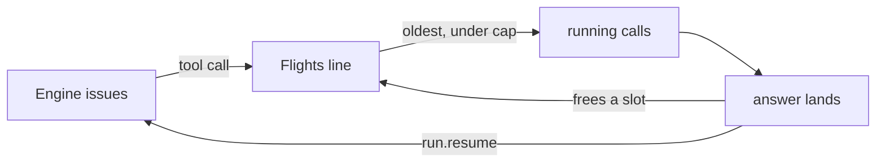

# Cap tool calls in flight, oldest first

### Context for a fresh reader

- Repository: `c:\Users\Vinnie\cursor\runvil` (git, branch `master`). Paths are relative to it.
- Baseline: commit `bc49d9670` (Close plan: easy-fixes). Every line number and count here was verified there; search by name if they have moved.
- Shell: PowerShell on Windows. `$env:NAME='value'; <command>` sets a variable for the rest of the session, which is harmless for the gates below.
- Terms:
  - *Engine*, *Harness*, and *Host*: the Engine runs a prompt and performs no I/O. The Harness performs its effects for a Host, the application running the prompt, such as the Workshop desktop app. The Engine and the Harness talk only through `run.step()`, which returns `Step::Pending { effects, events }` or `Step::Done`, and `run.resume(id, answer)`.
  - *Plugin*: a package of tools installed under a local name. A call to one of its tools is a *catalog call*, which the Engine issues as an `Effect::ToolCall`.
  - *chain*, *task*, and *fanout arm*: a chain is one line of execution in a run, a section's Lua running as a coroutine. A task is a chain that runs in the background, started with `tasks.spawn`. `tasks.fanout` starts one task, an arm, per item, and the arms run at the same time.
  - *effect*: one thing the Engine needs done, such as a model round or a tool call. Each has an `EffectId` from one run-wide counter, so ids follow issue order.
  - *round* and *batch*: one model reply inside `models.loop`, and the tool calls it asks for. Since `1ce5831d0`, the Engine issues a round's catalog calls in one step, one after another in call order, so a batch's calls get consecutive effect ids. It resumes the chain only when every call is answered. When the Engine stops short at a local tool or a task built-in, the calls after it go out later as a new batch. A script `tools.call` is a batch of one.
  - *orphan*: an issued effect whose chain the Engine has ended, for example by `tasks.cancel`. The Engine discards its answer but keeps the run open until the answer arrives.
  - *withdrawn*: a tool-call orphan the Engine lists in the step that orphaned it, so the caller can drop it.
  - *Stop* and *Cancel*:
    - Stop is the Workshop button. The Harness's `stop_round` drops every in-flight effect except tool calls whose descriptor sets `survives_stop` (the operator question, `user-input/ask`), and the run goes on.
    - Cancel ends the whole run. The run becomes *decided*, and the Harness drops everything.
- Plan record and commits:
  - When execution starts, copy this plan to `vibe/2026-10-11-6-tool-call-cap.md`, the next free number for that day. Mark each step `[completed]` in that copy as it lands.
  - Each commit message has a one-line summary, a body, `Design:` lines, and a `Plan: vibe/2026-10-11-6-tool-call-cap.md` trailer. Close with `Close plan: tool-call-cap`. Nothing is pushed.

<product-contract>

## Product Requirements

This plan bounds how many Plugin tool calls run at once across a whole run. The cap lives only in the Harness, which enforces it. The Engine lists the tool calls it withdraws when a task ends early. The Harness starts the oldest waiting call whenever a slot frees, so the oldest batch finishes first, and drops waiting calls on Stop, Cancel, or withdrawal.

- Problem and users:
  - Nothing limits tool calls in flight today. One round can ask for 50 fetches, or 8 fanout arms can each ask for 10, which is 80 at once. That can overload sites, hit provider rate limits, or swamp the Host.
  - This affects prompt authors, whose runs fan out, and Hosts such as the Workshop, which pay for the load.
- Goals:
  - At most `ToolPerformer::max_in_flight()` tool calls run at once in a run. The default is 10.
  - Oldest first: when a slot frees, the waiting call with the lowest effect id starts. A batch's calls have consecutive ids, so the oldest batch finishes before a newer one starts, and its chain gets its result as early as possible.
  - Nothing starves: every new call goes behind every call already waiting. A chain that runs forever has at most one batch out at a time, and each new batch goes to the back.
  - Stop and Cancel reach waiting calls as well as running ones.
  - A withdrawn call never starts, and one already running is dropped.
- Non-goals:
  - Changing what a stopped round returns. `models.loop` still discards the round.
  - Tool effect labels or an Ask mode.
  - Capping model rounds, timers, or store effects.
  - Withdrawing orphaned model rounds.
  - A queue in the Engine, or sharing `max_concurrency`.
  - A fill order that lets a later batch go ahead of a big batch's leftovers. Waiting needs more than the cap of calls at once, which mostly takes a fanout, and oldest-first cannot starve.
  - A Host-facing setting for the cap, or changing it mid-run. The real tool performer keeps the default of 10.
- Success criteria:
  - No run ever has more than the cap of tool calls running.
  - When a slot frees, the waiting call with the lowest effect id starts.
  - A Stop answers every waiting call that does not survive stops with `Dropped`, without starting it. A waiting call that survives stops starts once a slot frees.
  - A Cancel answers every waiting call `Dropped` without starting it.
  - Cancelling a task drops its waiting and running calls, and the run finishes without them.
  - Every existing test passes. Existing tests change only by the mechanical updates to exhaustive `Step::Pending` patterns; new tests and helpers may join existing files.
  - Every exit gate passes.
- Constraints:
  - The Engine stays sans-IO and deterministic. The order in which answers land stays an input the Engine records, so the Harness's start order changes no replay.
  - Every `.rs` file stays at or under 500 lines; the ceiling fails a file over 500. `harness-internal/runner/src/effect_loop.rs` is 487, so it may grow by at most 13 lines. The Harness's new logic and its prose go in `effect_loop-flight.rs` (181 lines).
  - Clippy `all` and `pedantic` deny, `unwrap_used` and `expect_used` deny outside tests, and dead code is fatal under the gate.
  - Engine docs and comments call the Harness "the caller" and name the Harness only to say a responsibility belongs to it, never how the Harness performs it (root `AGENTS.md`). `docs-claims.mjs` catches only lowercase and compound forms, so this is checked by review.
- Open questions: none.

## Functional Specification

Prompts behave as before, except that tool calls beyond the cap wait in the Harness and start oldest first. Stop, Cancel, and withdrawal now also reach calls that are waiting.

- Actors and workflows:
  - The Engine issues every tool call as today. Each step lists the tool calls it withdrew.
  - The Harness starts tool calls while fewer than the cap are running and holds the rest. Each time a running tool call lands or is dropped, it starts the waiting call with the lowest effect id.
- Inputs and outputs:
  - `EffectId` derives `PartialOrd` and `Ord`, so ids order by issue within a run.
  - `ToolPerformer::max_in_flight()` is a new trait method with a default of 10. A performer overrides it to set a different cap.
  - `Step::Pending` gains `withdrawn: Vec<EffectId>`: the tool-call effects this step orphaned while the run goes on, in effect-id order. A decided run's steps list none.
- States and validation:
  - **Order.** The lowest effect id starts first. Ids come from one run-wide counter in issue order (`Scheduler::issue`, `scheduler.rs` lines 305-307), and the Engine issues a batch's calls one after another, so a batch's calls are consecutive and the oldest batch goes first.
  - **Example.** With a cap of 10, batch A asks for 12 calls first, and batch B asks for 4 in a later step while A1 to A10 run:
    - A1 to A10, effect ids 1 to 10, start at once.
    - A11 and A12, ids 11 and 12, start next, as slots free.
    - B1 to B4, ids 13 to 16, start after A's.
- Errors and recovery:
  - Stop drops running and waiting tool calls that do not survive stops, and answers each `Dropped`. A call that survives stops keeps running, or keeps waiting and starts once a slot frees.
  - A decided run, or a Cancel, drops every waiting call along with everything in flight.
  - Withdrawn calls: for each id, a waiting call is dropped unstarted and answered `Dropped`, and a running call is dropped as Stop drops one and answered `Dropped`. Each effect gets exactly one answer, and an id the Harness no longer holds is ignored. The Engine discards answers for orphans, as today.
  - Store effects and model rounds are never withdrawn.
- Security and privacy behavior: unchanged. Each call still forks its own access when it is issued, so a waiting call already holds its identity. A batch's calls are concurrent siblings either way, so store claims behave as today.
- Acceptance criteria: the success criteria, each pinned by a test in the Testing Plan.

</product-contract>
<implementation-contract>

## Technical Design

The Harness owns the cap and the order. The Engine adds one list per step and one derive, and changes nothing in its batch code or in `Effect::ToolCall`. The Harness keeps waiting calls inside `Flights`, which already owns every in-flight effect and its Stop and Cancel paths. A waiting call is just a performer future that hasn't been polled yet, because the loop builds each tool call's future as an `async move` block that calls the performer only when polled (`effect_loop.rs` lines 340-353).



The declarations, with `// ...` standing for existing members that don't change. The `///` lines are the code's own docs; Engine docs follow the wording rule in Constraints.

```rust
// crates/runvil-internal/engine/src/execute/run/effect.rs
/// ... the existing doc, plus: Ids order by issue within a run: an effect
/// issued later has a greater id.
#[derive(Clone, Copy, Debug, PartialEq, Eq, Hash, PartialOrd, Ord)]
pub struct EffectId(pub(crate) u64);

// crates/runvil-internal/engine/src/execute/run.rs
pub enum Step {
    Pending {
        effects: Vec<(EffectId, Provenance, Effect)>,
        events: Vec<Event>,
        /// The tool-call effects this step orphaned, in effect-id order.
        /// Their answers will be discarded, so the caller may drop each one
        /// it still holds; it still owes each one answer. Empty once the
        /// run is decided, when the caller may drop everything it holds.
        withdrawn: Vec<EffectId>,
    },
    // ...
}

// crates/runvil-internal/engine/src/execute/scheduler.rs, new `Scheduler` field
/// Tool-call effects orphaned since the last step, drained into `Step::Pending`.
withdrawn: Vec<EffectId>,

// crates/harness-internal/runner/src/performers.rs
/// The tool calls a run has in flight at once unless its performer says
/// otherwise.
const DEFAULT_MAX_IN_FLIGHT: NonZeroUsize = NonZeroUsize::MIN.saturating_add(9);

pub trait ToolPerformer: Send + Sync {
    // ... call, survives_stop
    /// The most tool calls the Harness runs at once across the run; calls
    /// beyond it wait and start oldest first. The default is 10.
    fn max_in_flight(&self) -> NonZeroUsize {
        DEFAULT_MAX_IN_FLIGHT
    }
}

// crates/harness-internal/runner/src/effect_loop-flight.rs
/// Which held effects an abort reaches.
#[derive(Clone, Copy, Debug)]
pub(super) enum Reach<'a> {
    // ... All, AllButSurvivors
    /// The listed effects, waiting or in flight: the tool calls a step
    /// withdrew, in effect order.
    Withdrawn(&'a [EffectId]),
}

struct InFlight {
    // ... provenance, abort, survives_stop
    /// Whether the effect is a tool call, which counts toward the cap.
    tool_call: bool,
}

/// A tool call waiting for a slot: its performer future, not yet polled.
struct Waiting {
    provenance: Provenance,
    survives_stop: bool,
    answer: BoxFuture<EffectAnswer>,
}

pub(super) struct Flights {
    // ... futures, effects
    /// Tool calls waiting for a slot; the lowest id starts first.
    waiting: BTreeMap<EffectId, Waiting>,
    /// The most tool calls in flight at once.
    cap: NonZeroUsize,
}

impl Flights {
    pub(super) fn new(cap: NonZeroUsize) -> Self;
    // `start` loses its `survives_stop` parameter, which only tool calls set.
    /// Puts a chat or timer effect's future in flight. It never waits and
    /// never counts toward the cap.
    pub(super) fn start(
        &mut self,
        id: EffectId,
        provenance: Provenance,
        answer: BoxFuture<EffectAnswer>,
    );
    /// Queues a tool call's future, then starts waiting calls, lowest id
    /// first, while fewer than `cap` tool calls are in flight.
    pub(super) fn queue(
        &mut self,
        id: EffectId,
        provenance: Provenance,
        survives_stop: bool,
        answer: BoxFuture<EffectAnswer>,
    );
    // `abort(reach)` keeps its signature and also takes waiting calls.
}
```

### Step 1: the Engine reports withdrawn calls

- In [crates/runvil-internal/engine/src/execute/run/effect.rs](crates/runvil-internal/engine/src/execute/run/effect.rs): `EffectId` (line 43) adds `PartialOrd, Ord` to its derives, and its doc (lines 38-42) gains the sentence that ids order by issue within a run. `abort_subtree`'s `sort_unstable_by_key(|effect| effect.get())` (`chain.rs` line 256) can become `sort_unstable()`.
- In [crates/runvil-internal/engine/src/execute/scheduler.rs](crates/runvil-internal/engine/src/execute/scheduler.rs): `Scheduler` gains `withdrawn` beside `orphaned` (line 220), set empty in `new` (lines 255-270).
- In [crates/runvil-internal/engine/src/execute/scheduler/chain.rs](crates/runvil-internal/engine/src/execute/scheduler/chain.rs), `abort_effect` (lines 296-305): inside its `Continuation::ToolCall` arm, push the id onto `self.withdrawn`, and add a sentence to its doc. Every path that ends a chain with tool calls out reaches this arm: `tasks.cancel` (`cancel_task`, `waits.rs` line 311), an owner ending with live tasks (`abandon_owned_tasks`, `task_end.rs` line 153), and an owner aborted (`abort_subtree`).
- In [crates/runvil-internal/engine/src/execute/scheduler/drive.rs](crates/runvil-internal/engine/src/execute/scheduler/drive.rs):
  - `step` takes the buffer beside `effects` (line 56), sorts it, and returns it as `Step::Pending.withdrawn` (line 82). An id is pushed at most once, because `abort_effect` pushes only when it removes a pending entry.
  - `end` (lines 172-186) clears the buffer after `teardown`. A run's end abandons its live tasks through `settle_all_tasks`, which reaches `abort_effect` and fills the buffer, while `teardown` orphans the remaining pending effects straight from the table (lines 218-219), which doesn't. Clearing gives the field's simple promise: a decided run's steps list none, because the caller drops a decided run's effects whole.
- In [crates/runvil-internal/engine/src/execute/run.rs](crates/runvil-internal/engine/src/execute/run.rs): `Step::Pending` (lines 34-48) gains `withdrawn`, and the variant's doc gains a sentence on it.
- Every exhaustive `Step::Pending` pattern gains `withdrawn` or `..`; the compiler finds them. At baseline they are:
  - `crates/harness-internal/runner/src/effect_loop.rs` line 164;
  - `engine/src/test_support.rs` line 104 and `engine/src/test_support/tokio_driver.rs` line 200;
  - `engine/src/execute/tests/serial_driver.rs` line 199, `execute/tests/parallel_tool_calls.rs` line 21, `execute/tests/run_termination.rs` line 49, and `execute/run/tests.rs` line 286 (487 lines; edit in place);
  - `crates/runvil/tests/suite/event.rs` line 58 and `tests/suite/ids.rs` line 101;
  - `crates/runvil/examples/greeter.rs` line 107, which `tests/suite/greeter.rs` compiles through `#[path]`.

  Every other match already uses `..`. In this step the Harness ignores `withdrawn`, so behavior is unchanged.
- `crates/runvil/public-api.txt` is regenerated with `cargo +nightly-2026-09-05 xtask api --bless`, and the diff is reviewed. It should show only `EffectId`'s derives line (line 214) gaining `Ord` and `PartialOrd`, and a new `Step::Pending::withdrawn` line beside lines 736-737.

### Step 2: the Harness caps, orders, and drops

- In [crates/harness-internal/runner/src/performers.rs](crates/harness-internal/runner/src/performers.rs): `ToolPerformer` (lines 76-98) gains `max_in_flight()`, whose default body returns the private constant `DEFAULT_MAX_IN_FLIGHT`, `NonZeroUsize::MIN.saturating_add(9)`, so no `unwrap` is needed. No implementor changes. The real performer, `HostRunContext` (`host-run.rs` line 169), keeps the default, and test tools override it to set a small cap. The `harness` facade doesn't re-export `ToolPerformer`, so no public listing changes.
- In [crates/harness-internal/runner/src/effect_loop-flight.rs](crates/harness-internal/runner/src/effect_loop-flight.rs):
  - `Reach` (lines 30-37) gains `Withdrawn(&'a [EffectId])`, with a lifetime so it stays `Copy`. A withdrawal is a third reach beside a cancel and a stop, so it reuses `abort` and `drop_in_flight` instead of adding a method.
  - `InFlight` gains `tool_call`. The body of `start` (the span, `catch_unwind`, and `Abortable` wrapping) moves into a private helper with the `tool_call` flag. `start` calls it for chat and timer effects, and the fill helper calls it for tool calls. `start` drops its `survives_stop` parameter, which is always `false` for chat and timer effects.
  - `Flights` gains `waiting` and `cap`, and `new` takes the cap.
  - **`queue`** inserts the call into `waiting`, then fills.
  - **Fill**, a private helper: while fewer than `cap` tool calls are in flight and a call waits, it starts the waiting call with the lowest id (`BTreeMap::pop_first`). Counting tool calls by scanning `effects` is fine, since the map holds at most the cap plus the run's chat and timer effects.
  - **`poll_landed`** fills after removing a landed tool call, the panic path included, so a freed slot fills at once. The late end of an aborted future frees nothing, because its slot was filled when it was aborted.
  - **`abort(reach)`** takes waiting calls too, by the same reach: all of them for `Reach::All`, those that do not survive stops for `Reach::AllButSurvivors`, and the listed ones for `Reach::Withdrawn`. Inside the existing filter closure, a `Withdrawn` list is searched with `binary_search`, since the Engine sorts it.
    - It drops the waiting calls' unpolled futures, aborts the reached calls in flight, and returns both merged in effect order.
    - It fills once, after taking everything, so it never starts a call the same reach is about to take. That fill starts a waiting survivor once a stop has freed a slot, or the next call after a withdrawal.
    - Its `chosen.sort_by_key(|id| id.get())` (line 162) can become `sort_unstable()`.
  - **`len` and `is_empty`** count waiting calls too, since each still owes an answer. `act_on_stop` compares `len` before and after a stop, so its check stays correct with no change. `DriveError::Stalled` can't fire while calls only wait, because fill leaves a call waiting only while `cap` tool calls are in flight.
  - The module doc gains the cap, the waiting line, and the three reaches. Most of the prose goes here.
- In [crates/harness-internal/runner/src/effect_loop.rs](crates/harness-internal/runner/src/effect_loop.rs), about 11 lines net against a budget of 13:
  - `drive` reads the cap into a local, `let cap = performers.tool.max_in_flight();`, before building the `Driver`, because the struct literal moves `performers` before it builds `flights`. Then `flights: Flights::new(cap)`.
  - `perform`'s `ToolCall` arm sends its future through `self.flights.queue(...)` and returns `None`. The match's tuple becomes just the future, and chat and timer effects call `start` without the flag. Its doc says a tool call may wait.
  - The `Step::Pending` arm binds `withdrawn`. After the loop over the step's effects, when `withdrawn` is not empty, it calls `self.drop_in_flight(Reach::Withdrawn(&withdrawn))` and sets `answered`, so the loop steps again instead of awaiting. A one-line comment states the ordering constraint.
    - The order matters because an effect can be issued and withdrawn in the same step.
    - `drop_in_flight` answers each `Dropped`, then tears down the aborted futures through `answer_landed`. That gives a withdrawal the guarantee it documents for a cancel and a stop, so whatever a dropped performer held is gone before the run steps on.
    - A call that the stop check before the effects loop already dropped is no longer held, so the reach skips it.
    - The decided branch needs no change, because `abort(Reach::All)` now drains waiting calls too. A step the Engine decided lists no withdrawn ids. A step the branch takes only because the cancel flag fired may list some, and `Reach::All` reaches them with every other held call.
  - The module doc (lines 20-35) gains one sentence: tool calls beyond the performer's cap wait in the flights, oldest first, and a cancel, a stop, or a withdrawal reaches them as well. The `drop_in_flight` doc and the `flights` field doc on `Driver` (lines 134-137) mention waiting calls.
- In [crates/harness-internal/runner/src/harness-control.rs](crates/harness-internal/runner/src/harness-control.rs), docs only. The `harness` facade re-exports `RunControl`, so Hosts read these:
  - `stop_round` (lines 38-51): a stop also drops the tool calls waiting for a slot, unstarted, except those that survive stops, which start once a slot frees.
  - `cancel` (lines 56-61): every waiting call is answered `Dropped` too, unstarted.
- In [crates/harness-internal/runner/src/harness.rs](crates/harness-internal/runner/src/harness.rs), docs only: `Harness::new` (lines 126-132) says a run has at most 10 tool calls in flight, and the rest wait and start oldest first. Hosts see no other trace of the cap.
- Unchanged: the `Harness`, `RunRequest`, and `RunControl` API, `Performers`, `drive_run`, the recorder, the Workshop, `Effect::ToolCall` and its record, the Engine's batch code and `models.loop`, and the `AssistantToolCalls` and `ToolResult` events.

</implementation-contract>
<verification-contract>

## Testing Plan

The Engine tests step a run by hand and read each step's `withdrawn` directly. The Harness tests drive real runs with gated or held tools and observe what started. Through `drive_run`, the test tool overrides `max_in_flight` to set a small cap. Through `Harness::run`, the tests get the real performer's default of 10. `EffectId` has no public constructor, so `Flights` is tested through those runs, not in isolation.

Every new behavior has a test that fails without it. A missing drop usually shows up as a hang, so every Harness test runs under a timeout: `run_beside`'s 10-second `PATIENCE` (`tests/it/harness.rs` lines 43 and 91-103), or `tokio::time::timeout` around `drive_run` as `tests/it/effect_loop.rs` line 271 does.

- Integration, Step 1, added to `crates/runvil-internal/engine/src/execute/tests/parallel_tool_calls.rs` (296 lines) beside the cancel test they mirror, `cancelling_a_task_parked_on_a_batch_orphans_every_call` (line 242). Its helpers `calls_reply`, `tool_text`, and `only_effect` are private to that file, which is why the tests go there and not in a new module.
  - The three tests share a new `const` holding that test's Main and Child prompt; the existing test keeps its inline copy.
  - A new helper returns a step's `withdrawn` beside its effects, since `pending` drops it.
  - The module doc gains a clause on the withdrawn list.
  - Each test steps the run with `run.step()`.
  - `cancelling_a_task_withdraws_its_unanswered_tool_calls`:
    - The step that cancels lists both tool-call ids in `withdrawn`, in effect-id order. Every earlier step lists none.
    - Answering both `Dropped`, then Main's `linger` round, ends the run `RunResult::Ok("cancelled")`.
  - `a_call_issued_and_withdrawn_in_one_step_is_listed_twice`:
    - The test resumes the child's round with two calls and then Main's `wait` round before stepping, so the next step runs the child first and Main second.
    - That one step lists both calls in `effects` and again in `withdrawn`. This is the contract the Driver's issue-then-withdraw order relies on.
    - Answering everything outstanding ends the run `RunResult::Ok("cancelled")`.
  - `a_decided_run_lists_no_withdrawn_calls`:
    - The test calls `run.cancel()` while the child's two calls are out.
    - The next step reports `run.decided()` and lists nothing in `withdrawn`, though the run's end abandoned the child through `abort_effect`. Without the clear in `end`, it would list both.
    - Answering everything outstanding `Dropped` reaches `Done` with `RunResult::Cancelled`.
- End-to-end, Step 2, through `drive_run`, in a new `crates/harness-internal/runner/tests/it/effect_loop-cap.rs`. Declare it in `tests/it/effect_loop.rs` beside its siblings as `#[path = "effect_loop-cap.rs"] mod cap;` (lines 28-33), not in `main.rs`. A run with a model round builds its own prompt, model, and tool catalog, as `effect_loop-broker.rs` does (lines 40-58), with the tool offered to the model. Shared fixtures come from `support.rs` and the parent module (`begun_log`, `answers`).
  - New helpers go in this file, because `support.rs` is at 486 lines:
    - One test tool, built on the pattern of `GatedTool` (`support.rs` lines 372-400), with the cap override, a gate, a log of the calls it started in start order, and a teardown counter. The `Held` fixture can't serve, because its `hold` is private to `scripted.rs`.
    - A scripted broker that answers each round by its last message, and can hold a round until a condition is met.
  - Before asserting that a call has not started, yield a few times, as `harness-stop.rs` does with 16 `yield_now` calls, so the check isn't vacuous.
  - `the_cap_holds_extra_calls_until_one_lands`:
    - A cap of 2, and one round of three gated calls.
    - Wait until 2 have started, and check that the third has not.
    - Add one permit, then check that the third starts. Add the rest, and the run completes.
  - `waiting_calls_start_oldest_first`:
    - A cap of 1. Chain A's round asks for 3 calls. Then chain B's round, which the broker answers only after a1 has started, asks for 1.
    - Wait until B's call is recorded as an effect before opening the gate. The loop queues each effect right after recording it, with no await in between, so on `#[tokio::test]`'s current-thread runtime a recorded call is already queued.
    - Open the gate for all four. The tool records start order a1, a2, a3, b1. A wave order or a newest-first order would start b1 before a2.
  - `a_call_withdrawn_in_the_step_that_issued_it_never_starts`:
    - A cap of 2, and the Engine tests' Main and Child prompt.
    - The broker answers the child's round with two gated calls at once. It holds Main's `wait` round until the child's round has completed, then wakes it. Both answers then land in the same `answer_landed` drain, the child's first, so one step issues the two calls and withdraws them.
    - Expect no call started, two `Dropped` answers, and the run to complete. If the Driver withdrew before queuing, the reach would find nothing, both calls would start and hold forever, and the timeout would fail the test.
  - `cancelling_a_task_drops_its_waiting_and_running_calls`:
    - A cap of 1, and a child task whose round asks for two held calls.
    - The main chain cancels the child once one of them has started. The trigger is a main model round that the test's broker answers only after that call has started.
    - Expect exactly one start, one teardown, both calls answered `Dropped`, and the run to complete.
  - `a_cancel_drops_waiting_calls_without_starting_them`:
    - A cap of 1, and one round of two held calls.
    - Once one has started, fire the run's `CancelHandle`.
    - Expect `RunOutcome::Cancelled`, exactly one start, and two `Dropped` answers. A `Reach::All` that missed the waiting call would let fill start it after the cancel, for two starts.
- End-to-end, Step 2, through `Harness::run`, in a new `crates/harness-internal/runner/tests/it/harness-stop-cap.rs`. Declare it in `tests/it/harness.rs` beside `stop` and `stop_timing` (lines 31-36), because `harness-stop.rs` is at 415 lines and two tests with their helpers would pass 500. The file has its own prompt and broker, shaped like `LOOPS_ONCE` and `calls_hold_twice` in `harness-stop.rs`, which are private there.
  - `a_stop_drops_waiting_calls_without_starting_them`:
    - The default cap of 10, and one round of 11 `harness/hold` calls.
    - Wait until 10 have started, then call `stop_round()`.
    - Expect `final_text` `"false:cancelled"`, `held.started() == 10`, `held.dropped() == 10`, and 11 `Dropped` answers in `answers_to(&records, "ToolCall")`.
  - `a_stop_starts_a_waiting_call_that_survives_stops`:
    - The default cap of 10, and one round of 10 `harness/hold` calls followed by one call to the fixture ask tool. The prompt offers both with `tools.always_offer`, and the ask tool's wire name is expected to be `user-input_ask`. The Host is `with_asker(hold_host(..))` with an `Operator`.
    - Wait until 10 holds have started, and check that no question has been asked.
    - Call `stop_round()`. The question is asked once the stop frees the slots. Answer it.
    - Expect the 10 holds dropped, the question's answer recorded as a non-`Dropped` `ToolCall` answer, and `final_text` `"false:cancelled"`, since the batch answers with its first failure in call order.
- Regression:
  - The existing tests pass unchanged, apart from the mechanical `Step::Pending` updates. That includes `parallel_tool_calls.rs`, whose existing tests stay as they are beside the new ones, `batch_turn.rs`, `tool_call_access.rs`, and `models_loop.rs`.
  - `harness-stop.rs` passes, including the two-calls-in-flight test, under the default cap of 10. The default applies to every test performer too. At baseline no Harness, Workshop, or Plugin test uses `tasks.fanout` or builds a call list in a loop, and the largest round in `harness-stop.rs` asks for two calls.
  - The serial and tokio test drivers in `engine/src/test_support*` keep performing every effect, ignore `withdrawn`, and have no cap.
- Exit criteria, run at the end of each step:
  - `cargo nextest run --locked --workspace --exclude workshop --exclude workshop-server --exclude workshop-server-api --all-features`
  - `$env:CARGO_BUILD_WARNINGS='deny'; cargo clippy --workspace --exclude workshop --exclude workshop-server --exclude workshop-server-api --all-targets --all-features`
  - The Workshop crates, with the gateway sidecar staged:
    - Stage it: `cargo build --locked -p gateway --no-default-features`, then `node tools/stage-gateway-sidecar.mjs stage --target x86_64-pc-windows-msvc --source target/debug/runvil-gateway.exe`.
    - Run `cargo nextest run --locked -p workshop -p workshop-server -p workshop-server-api` and `$env:CARGO_BUILD_WARNINGS='deny'; cargo clippy -p workshop -p workshop-server -p workshop-server-api --all-targets`.
    - Always run `node tools/stage-gateway-sidecar.mjs remove --target x86_64-pc-windows-msvc` afterward, even when a command failed.
  - `cargo fmt --all --check`
  - `$env:RUSTDOCFLAGS='-D warnings'; cargo doc --workspace --no-deps --all-features --exclude workshop --exclude workshop-server --exclude workshop-server-api`, then `cargo doc -p runvil --no-deps` with the same flags
  - `cargo +nightly-2026-09-05 xtask api --check`, after Step 1's reviewed `--bless`
  - `cargo test -p build-xtask`, which includes the 500-line ceiling and `no_doctests`
  - `node --test crates/workshop/ui/test/docs-claims.mjs`

</verification-contract>
<decision-record>

## Decision Record

The design moved from an Engine queue, to an Engine-ordered line with the cap in both halves, to a cap that lives only in the Harness with waves computed from an Engine index, and finally to oldest-call-first with no index. The user set each turn of that shape. A review against the code showed that the wave rule could starve an earlier batch's leftovers. The user then chose the simplest order that cannot starve.

- Decisions:
  - The Engine hands every call to the Harness, and the Harness enforces the cap. User: "maybe the Engine should not maintain its own queue and it should instead just give the entire batch to the harness, and the harness is told the max tool limit".
  - The cap lives only in the Harness. User: "I wish we didn't need the cap in both the engine and the harness".
  - Waiting calls start oldest first, by effect id. User: "What if we just complete the whole batch first? Like always prioritize completing a batch because that lets us give, get a result" and "If we get a batch, then we want to finish that batch."
    - A batch's chain resumes only when every call in it has an answer, because the model's next request must answer every call it asked for. So finishing the oldest batch first gets a chain its result soonest.
    - It cannot starve: every new call goes behind every call already waiting.
    - It orders by when a batch was issued, not by how old its chain is. The user worried about "a chain that just runs forever". Such a chain has at most one batch out at a time, and each new batch goes to the back, so it cannot hog the slots.
    - Waiting is rare. User: "how often are we going to get 10 tool calls at once? ... 10 concurrent tool calls is quite a lot." Waiting mostly takes a fanout, so the simplest order that cannot starve wins over a cleverer one.
    - It keeps an earlier wish: "the harness is dumb it just forms Vec<Effect> into a heap and picks the lowest number". The effect id is that number, so no new field is needed.
  - A withdrawn list reports orphaned tool calls. User: "this seems alright I guess."
  - Public format changes are acceptable. User: "public format changing is not a problem at all. no one depends on this yet."
  - Defaults chosen in planning, open to override:
    - The cap comes from `ToolPerformer::max_in_flight()`, a default method returning 10:
      - The tool performer is what runs the calls, so it knows its capacity.
      - A default method changes no implementor, no `Performers` literal, and no `drive_run` call.
      - Tests override it to set a small cap.
    - The default is 10, separate from `max_concurrency`. Harnesses cluster at 8 to 10 (Claude Code 10, Mastra 10, CrewAI 8), and every harness surveyed keeps tool-call and subagent limits separate.
    - `EffectId` derives `PartialOrd` and `Ord`, which serve the waiting line's key, the withdrawn sort, and the existing sorts in `abort_subtree` and `Flights::abort`. Its doc states the order as a guarantee: ids order by issue within a run.
    - `withdrawn` is a field on `Step::Pending`, not a `Run` query. It's per-step data, so it belongs in the per-step value. A query valid only until the next step would tie callers to calling it in the right order, which is temporal coupling.
    - A decided run's steps list no withdrawn calls: `end` clears the buffer. The run's end reaches `abort_effect` for its live tasks but orphans the rest through `teardown`, so a list there would be partial, and the caller drops a decided run's effects whole anyway.
    - Waiting calls live inside the Harness's existing `Flights` as unpolled performer futures. Stop, Cancel, and landings already pass through `Flights`, so no new file or `Driver` state is needed.
    - A withdrawal is a third `Reach`, so `abort` and `drop_in_flight` serve it. It gets the same merge, sort, fill, and teardown as a cancel or a stop, and `Flights` gains one method, `queue`, not two.
    - `Flights::start` loses its `survives_stop` parameter, since only tool calls set it and tool calls now go through `queue`.
    - A withdrawn call that is already running is dropped too, matching what Cancel does to a run, and freeing its slot.
    - Calls that survive stops count toward the cap like any other tool call. A waiting one keeps waiting through a Stop and starts once a slot frees. The trade-off: an operator question can wait behind slow calls, and the operator sees it only once it starts.
- Rejected alternatives:
  - Waves: an `index` on every `Effect::ToolCall` (its batch slot), and a Harness wave of `base + index / cap`, with a new batch's base set to the lowest wave the Harness still held. Reason: the wave a newcomer joins never moves forward while newcomers keep joining it. Two chains issuing batches back to back, or one long call such as an open operator question, can leave an earlier batch's leftovers waiting indefinitely. It also adds an Engine field for a rare case. That was the plan's previous design.
  - Waves that join the next round (base one past the wave started most recently), or a per-task floor on the base. Reason: fair, but more machinery than a case that rarely occurs needs.
  - Smallest batch first. Reason: a large batch waits as long as smaller ones keep arriving, and the Harness would have to count each batch before placing it.
  - One call per batch, interleaved. Reason: it needs a placement rule for each newcomer's first call, with the same starvation risk as waves, and a batch only helps its chain when complete, so every batch finishes late.
  - Oldest chain first. Reason: a chain that runs forever would always win.
  - The Engine computing a ready-made sort number from the cap, with `RunLimits::max_tool_calls`, `Run::limits()`, a `sort` field on each continuation, and a scan for the lowest open number. Reason: both halves would need the cap and must agree on it.
  - A separate `WaitingLine` type in its own file, with new `Driver` fields. Reason: `Flights` already owns every in-flight effect and its drop paths.
  - A `Flights::withdraw(ids)` method answered by its own loop in the `Driver`, this plan's earlier shape. Reason: it repeated `abort`'s take, merge, sort, and fill, and its loop skipped the teardown that `drop_in_flight` gives a cancel and a stop.
  - The cap as a `drive_run` parameter or a `Performers` field. Reason: both change every call site or literal in the runner's tests, where a default trait method changes none.
  - `Harness::with_limits`, or a `limits` field on `RunRequest`. Reason: the mechanism and its tests don't need it, and `RunRequest` is built by struct literal in about 19 places. See Deferred.
  - A queue in the Engine. Reason: Stop can't reach calls the Harness never saw, and it needs slot bookkeeping across parking, resuming, and aborting.
  - Sharing `max_concurrency`, with a chain giving its slot back while it waits. Reason: it couples task and call limits and reworks admission. No surveyed harness does it.
  - Raising the limit while a chain waits. Reason: it makes the cap soft and lets limits leak through `tasks.concurrency`.
  - Per-batch windows held back in the Engine. Reason: more Engine logic for what the Harness's line already does.
  - A shared `Arc` cancellation flag inside `Effect`. Reason: effects stop being plain recorded data, the withdrawal becomes invisible to logs and tests, and a bool can't stop a running call.
  - A `BinaryHeap` for the waiting line. Reason: it can't remove a withdrawn call from the middle.
  - Letting calls that survive stops bypass the cap. Reason: `survives_stop` is a Stop flag and should not gain a second meaning.
- Assumptions, risks, and notes:
  - Effect ids follow issue order (`next_effect`, `scheduler.rs` line 230, advanced in `issue`, lines 305-307), and `dispatch_tool_calls` issues a batch's calls one after another, so lowest id first finishes the oldest batch first.
  - Performers do nothing until polled. `perform` wraps each tool call in an `async move` block that calls the performer inside it (`effect_loop.rs` lines 340-353), so a waiting future has started nothing. `survives_stop` is read when the effect is performed (line 347), before the call waits.
  - The Harness answers each landed call before it steps, and drains any already-landed peers first (`await_answer` and `answer_landed`), and fill runs inside `poll_landed`, so freed slots refill at once.
  - A big batch holds later batches behind it: with a cap of 10, a 40-call batch holds a later 1-call batch for four rounds. This is accepted, because waiting needs more than the cap of calls at once, and they come from the prompt's own fanout or rounds.
  - No tool-call "started" event exists. The Engine reports `AssistantToolCalls` before dispatch and `ToolResult` on landing, so a waiting call is simply shown as running until its result arrives.
  - The order in which the Harness starts calls changes landing order only, which the Engine already records as input. Replays are unaffected.

### Deferred and Out of Scope

- A Host setting for the cap. `HostRunContext` would answer `max_in_flight` from a Host-supplied value. Revisit when a Host needs a non-default cap.
- Changing the cap mid-run from the Host. This is Harness-only: re-read `max_in_flight` each step, or add a `RunControl` method beside `stop_round`. Revisit if operators ask.
- Changing the cap mid-run from a prompt. It needs a way for the Engine to tell the Harness the new value. Revisit if a prompt needs it.
- A fill order that lets a later batch go ahead of a big batch's leftovers. Revisit if a real prompt shows one batch holding up others.
- A stopped round keeps finished results and answers the rest with synthetic "cancelled" results, as Claude Code, Codex, Gemini CLI, and Pydantic AI do, instead of discarding the round. Model APIs such as Anthropic's and OpenAI's reject a request that leaves any requested call without a result, which is why a round today is either appended whole or not at all. Revisit at the next `models.loop` failure-semantics change.
- Tool effect labels on `ToolDescriptor` (MCP-style read-only, destructive, idempotent, and open-world, with the MCP Plugin passing server annotations through) for a future Ask mode, with calls not marked read-only running alone. Revisit when Ask mode is planned.
- Harness-reported started events, so the transcript can show waiting apart from running. Revisit if operators ask.
- Withdrawing orphaned model rounds to save tokens. Revisit if a cancelled task's model spend matters.

</decision-record>
<project-survey>

## Project Survey

- Status: complete
- Build command: `cargo build --locked -p gateway`.
  - `crates/gateway/app` is the workspace's only default member, so plain `cargo build` builds the same thing. The desktop app builds with `cargo workshop`, an alias for `run -p build-workshop --` in `.cargo/config.toml`, which also sets the Windows `rust-lld` linker with the static CRT.
  - The `gateway-config-ui` and `workshop-server` build scripts bundle their UIs with esbuild through `build-ui`, so workspace-wide commands need Node.js plus one `npm ci --prefix crates/workshop` and one `npm ci --prefix crates/gateway/config-ui/ui` per checkout. Both installs are present on this machine, along with Node.js 24.19 (CI uses 22), cargo-nextest 0.9.128, stable Rust 1.99.0, `nightly-2026-09-05`, mdBook 0.4.44, cargo-deny 0.20.2, cargo-audit 0.22.2, and cargo-hakari 0.9.38.
  - Workshop clippy and tests need the gateway sidecar staged for Tauri's `externalBin`: `cargo build --locked -p gateway --no-default-features`, then `node tools/stage-gateway-sidecar.mjs stage --target x86_64-pc-windows-msvc --source target/debug/runvil-gateway.exe`, and `node tools/stage-gateway-sidecar.mjs remove --target x86_64-pc-windows-msvc` afterward. The staging directory `crates/workshop/desktop/binaries/` is gitignored and empty now, so nothing is staged.
- Focused test command pattern: `cargo nextest run --locked -p <crate> --all-features <test-name-filter>`, such as `-p runvil-engine parallel_tool_calls` or `-p harness-runner effect_loop`. Drop `--all-features` for `workshop`, `workshop-server`, and `workshop-server-api`, which CI never builds with all features.
- Component test command pattern: `cargo nextest run --locked -p <crate> --all-features`, with the same three exceptions. `cargo test -p build-xtask` runs the boundary and structural checks, and `cargo xtask tidy` prints the same report.
- Full-suite test command:
  - `cargo nextest run --locked --workspace --exclude workshop --exclude workshop-server --exclude workshop-server-api --all-features`, then `cargo nextest run --locked -p workshop -p workshop-server -p workshop-server-api` with the sidecar staged. The first run includes `build-xtask`.
  - CI also runs `cargo nextest run --locked -p workshop-workspace --all-features`, `cargo nextest run --locked -p workshop-server --features headless`, and five launch-lease tests by name: one in `gateway-api-discovery` and four through `cargo test --locked -p gateway --no-default-features --features test-fixtures --test it <name>`.
  - The wording and rulebook scan: `node --test crates/workshop/ui/test/docs-claims.mjs`. It needs no `npm ci` and runs from any directory.
  - The UI suites: `npm test --workspaces --if-present` in `crates/workshop` and `npm test` in `crates/gateway/config-ui/ui`.
  - This plan's gates are the commands in its Testing Plan's exit criteria. Its Workshop runs need the sidecar staged, as CI's `check-workshop` job does.
- Linter command:
  - `cargo clippy --workspace --exclude workshop --exclude workshop-server --exclude workshop-server-api --all-targets --all-features` and `cargo clippy -p workshop -p workshop-server -p workshop-server-api --all-targets`, both with `CARGO_BUILD_WARNINGS=deny` (in PowerShell, `$env:CARGO_BUILD_WARNINGS='deny'`).
  - Never run a standalone `cargo check --workspace` beside them. The one exception is `cargo check -p gateway --no-default-features`, the headless build shape clippy does not cover.
  - UI type checks: `npm run typecheck --workspaces --if-present` in `crates/workshop` and `npm run typecheck` in `crates/gateway/config-ui/ui`.
  - Supply chain, run in CI: `cargo deny check`, `cargo audit`, `cargo hakari verify`, and a `cargo tree --locked -p gateway -e normal -i ring` check that `ring` stays out of the gateway's normal closure.
  - The pre-push hook runs the wording scan, the headless check, the non-Workshop clippy run, and `cargo deny` when it is installed.
- Formatter check command: `cargo fmt --all --check`, with `style_edition = "2024"` in `rustfmt.toml`. The pre-commit hook runs it, and `core.hooksPath` is set to `.githooks`.
- Docs command:
  - Each with `RUSTDOCFLAGS="-D warnings"` (in PowerShell, `$env:RUSTDOCFLAGS='-D warnings'`): `cargo doc --workspace --no-deps --all-features --exclude workshop --exclude workshop-server --exclude workshop-server-api`, `cargo doc -p runvil --no-deps`, `cargo doc -p harness --no-deps`, `cargo doc --locked --no-deps --all-features -p runvil-engine --document-private-items`, and `cargo doc --locked --no-deps -p workshop-server --document-private-items`. The facade docs build with default features on purpose.
  - The facade surface check: `cargo +nightly-2026-09-05 xtask api --check` against `crates/runvil/public-api.txt`, and `--bless` regenerates the listing. The nightly is pinned in `crates/build-xtask/src/api/toolchain.rs`, and its fixtures run with `cargo +nightly-2026-09-05 nextest run --locked -p build-xtask --run-ignored only`.
  - Public listings: only `crates/runvil/public-api.txt` exists. The `harness` facade (`crates/harness/src/lib.rs`) re-exports `BoxFuture`, `InferenceBroker`, `Timer`, `RunControl`, and `Harness`, not `ToolPerformer`, so `RunControl`'s and `Harness::new`'s docs are where Hosts learn about the cap and waiting calls.
  - The documentation site: `cargo xtask site [--books-only]`, which needs `RUNVIL_DOCS` naming a `runvil-docs` checkout and an mdBook binary (`MDBOOK`, default `mdbook`).
- Test placement and naming conventions:
  - Unit tests mostly sit in a sibling file wired with `#[cfg(test)] #[path = "<stem>-tests.rs"] mod tests;`, as in 176 files, such as `crates/runvil-internal/parser/src/build-tests.rs`. A module whose tests reach three files keeps them in a `tests/` subdirectory beside it, one file per topic. There are 18 of these, including `crates/runvil-internal/engine/src/execute/tests/` and `crates/runvil-internal/lua/src/protocol/tests/`. Inline `#[cfg(test)] mod tests { }` blocks remain in 141 files.
  - Integration tests compile as one binary per crate: from `tests/it/main.rs` in 18 crates, and from `tests/suite/main.rs` in `harness` and `runvil`. Each topic is one module file, and shared helpers go in `support.rs`.
  - In `harness-runner`, `tests/it/main.rs` declares only top-level modules. The `effect_loop-*.rs`, `harness-*.rs`, and `prepare-*.rs` siblings are declared from `effect_loop.rs`, `harness.rs`, and `prepare.rs` with `#[path]` (so `harness-stop.rs` is the module `harness::stop`). A child module can use its parent's private helpers, such as `begun_log` and `answers` in `effect_loop.rs` and `run_beside`, `until`, and `answers_to` in `harness.rs`. Top-level `tests/` trees are exempt from the flat-directory rule.
  - Private fixtures: the helpers in the Engine's `execute/tests/parallel_tool_calls.rs` are private to it. `Held::hold` (`tests/it/scripted.rs` line 164) is private, while `Held`'s `started` and `dropped` getters, `hold_host`, `with_asker`, `Operator`, and `ScriptedBroker` are `pub(crate)`.
  - `harness-runner` tests run on `#[tokio::test]`'s current-thread runtime, and none sets a flavor. The `Held` fixture (`tests/it/scripted.rs` lines 145-181) counts a future as started on its first poll and as dropped on teardown, so an unstarted waiting call counts as neither.
  - A few crates keep standalone test files directly in `tests/`: `gateway-stt-engine` (three files), `gateway-stt-backend-whisper` (four `native_*` files), `gateway-cloud-providers`, and `build-workshop`. There are two benches, both with `harness = false`: `benches/models_loop.rs` in `runvil-engine` and `benches/surface.rs` in `runvil-lua`.
  - Test names are snake_case sentences stating the behavior, such as `a_rounds_catalog_calls_are_issued_in_one_step_and_append_in_call_order`.
  - Doctests are banned. `build-xtask`'s `no_doctests` check fails any doc comment holding a code block rustdoc would compile, so doc examples use non-Rust fences.
  - Nightly-only `build-xtask` fixtures and the native speech and CUDA tests are `#[ignore]`d. `.config/nextest.toml` puts `gateway-stt` and `gateway-stt-backend-whisper` in a `heavy` test group (eight threads, four per test) and gives the gateway's realtime STT noise and capture tests a longer timeout.
- Directory map:
  - `crates/`: all 52 Cargo packages. The top level holds the public and shared layer: the `runvil` facade, `runvil-plugin`, `harness`, `harness-gateway-client`, `gateway-api-types`, `gateway-api-discovery`, the `plugin-*` crates (`plugin-web`, `plugin-user-input`, `plugin-mcp`), `shared-error-source`, `shared-loopback`, the `build-*` tooling (`build-ceiling`, `build-llama-cuda`, `build-ui`, `build-user-guide`, `build-workshop`, `build-xtask`), and `workspace-hack`.
  - `crates/runvil-internal/`: the Engine's private crates `types`, `engine`, `lua`, `parser`, `vfs`, and `model-client`. The scheduler this plan touches is `engine/src/execute/scheduler/`, beside `engine/src/execute/run/`.
  - `crates/harness-internal/runner`: the Harness's private per-run runner, including the effect loop (`src/effect_loop.rs`), the performers (`src/performers.rs`), and the package registry (`src/packages.rs`).
  - `crates/gateway/`: the gateway's private crates `app`, `cloud-providers`, `config`, `config-ui`, `local`, `logging`, `progress`, `protocol`, `routing`, and `web-search`, plus the `stt/` subsystem (`api`, `engine`, `backend-whisper`, `whisper-ffi`).
  - `crates/workshop/`: Workshop's crates `desktop` (package `workshop`), `server`, `server-api`, `agents`, `gateway`, `menu`, `protocol`, `registry`, `run-log`, `status`, `support`, `user-state`, and `workspace`, plus the npm workspace packages `ui`, `look`, and `platform`.
  - `crates/shared-ui`: a TypeScript and CSS package the gateway config UI uses, excluded from the Cargo workspace.
  - `guide/`: the `books`, `chrome`, and `landing` pieces of the mdBook site. The chapters live in the separate `runvil-docs` checkout.
  - `prompts/`: five example prompt files. `images/`: README art.
  - `tools/`: Node scripts for staging the gateway sidecar and a live TTS check, each with a `.test.mjs`.
  - `vibe/`: plan records, recent ones at the top level and older ones filed by month (`2026-07` through `2026-10`), plus an ignored `scratch/`.
  - `.github/workflows/`: `ci.yml`, whose `ci-green` job is the single gate, plus release, nightly, site, Miri, native-library, and installer smoke workflows.
  - `.config/`: `nextest.toml` and `hakari.toml`. `.githooks/`: pre-commit and pre-push. `.cursor/rules/`: the Workshop architecture and SPA rules. Rulebooks: the root `AGENTS.md` plus 21 crate-level `AGENTS.md` files.
  - Not tracked: `local/`, `target/`, and `target-msrv/` (ignored), and `cabinet/`, which holds only an empty `_trash/`. The working tree is clean at `bc49d9670` (`Close plan: easy-fixes`).
- Component boundaries, which `cargo test -p build-xtask` enforces across normal, dev, and build dependencies:
  - The Engine (`runvil*`) depends on no gateway, Workshop, Harness, or Plugin crate. Outside crates reach it only through `runvil` and `runvil-plugin`, the only two crates that may enter `runvil-internal/`.
  - Inside the Engine: `types` and `vfs` depend on no Engine crate, `model-client` on `types`, `lua` on `types`, `vfs`, and `model-client`, `parser` on `types` and `lua`, and `engine` on all five. The facade depends on all six, and `runvil-plugin` names only `types` and `vfs`. `crates/runvil/public-api.txt` pins the facade's surface.
  - Inside the Engine's scheduler, withdrawals happen only inside a step: `cancel_task` (`scheduler/waits.rs`), `abandon_owned_tasks` (`scheduler/task_end.rs`), and `abort_subtree` (`scheduler/chain.rs`) run from a chain's step or end. The one path from `resume`, a fatal answer (`drive.rs` line 105), goes through `end` (`drive.rs` line 172), so clearing the buffer in `end` covers it.
  - The Harness chain runs `harness-gateway-client` on `harness`, `harness` on `harness-runner`, and `harness-runner` on `runvil` and `runvil-plugin`. Outside its family the Harness names only `runvil`, `runvil-plugin`, and `workspace-hack`, except that `harness-gateway-client` depends on `plugin-web` to implement its `SearchProvider`. Outside crates reach the Harness only through `harness` and `harness-gateway-client`, and only `harness` may enter `harness-internal/`.
  - Plugin crates depend only on `runvil-plugin`, `shared-*` crates, `workspace-hack`, and outside libraries. Their only dependents are `harness-gateway-client`, `workshop-server`, and `workshop-agents`.
  - The gateway (`gateway*`) depends on no Engine, Workshop, Harness, or Plugin crate. Outside crates reach it only through `gateway-api-types` and `gateway-api-discovery`. Inside the family, only `gateway-stt` is visible outside `gateway/stt/`.
  - Workshop is a Host. It reaches the gateway only through that public pair, the Engine only through `runvil` and `runvil-plugin`, and the Harness only through `harness` and `harness-gateway-client`. Its tiers depend one way: the server on features (`agents`, `workspace`, `user-state`, `run-log`), features on services (`menu`, `gateway`, `status`), and services on vocabulary (`protocol`, `registry`, `support`). The desktop app names only `workshop-server-api`, which names only `workshop-server`.
  - `shared-*` crates depend on no product crate. `build-*` crates are tooling and may depend into any container.
- Conventions summary:
  - Engine, Harness, Host, and Plugin are capitalized with one meaning each. Engine crates say "the caller" and never mention the Host. `docs-claims.mjs` enforces what a scan can see in every `AGENTS.md`, every `## Invariants` crate doc, and every `.cursor/rules` file.
  - 25 crate `lib.rs` files open with a `//!` doc that has a `## Invariants` section.
  - Every crate build script (51 of them) calls `build_ceiling::check()`, which fails that crate's build when any `.rs` file under its `src`, `tests`, `benches`, or `examples` is over 500 lines (`LIMIT = 500`), so a 500-line file passes. `cargo test -p build-xtask` checks that every crate wires the call. Splits go into private child modules without widening visibility.
  - Sizes of the files this plan touches. Engine, under `crates/runvil-internal/engine/src/execute/`: `run/effect.rs` 403, `run.rs` 266, `scheduler.rs` 321, `scheduler/chain.rs` 306, `scheduler/drive.rs` 221, `run/tests.rs` 487, `tests/parallel_tool_calls.rs` 296. Harness, under `crates/harness-internal/runner/src/`: `effect_loop.rs` 487, `effect_loop-flight.rs` 181, `performers.rs` 129, `harness.rs` 280, `harness-control.rs` 127. Harness tests, under `crates/harness-internal/runner/tests/it/`: `effect_loop.rs` 376, `harness.rs` 344, `harness-stop.rs` 415, `support.rs` 486.
  - Clippy `all` and `pedantic` deny, `unwrap_used` and `expect_used` deny outside tests, and `allow_attributes` deny, so suppressions use `#[expect(..., reason = "...")]`. `missing_docs`, `missing_debug_implementations`, and `unreachable_pub` warn, which is fatal under the gate. `unsafe_code` is denied outside its owned boundaries, rustdoc's broken and private intra-doc links deny, and `clippy.toml` bans process-global installers outside binary entry points.
  - Source directories stay flat until a group reaches three files. Below that, kebab siblings such as `foo-bar.rs` are wired with `#[path]`.
  - Tool wire names: the model sees `harness/hold` as `harness_hold` (`tests/it/harness-stop.rs` line 178) and `user-input/ask` as `user-input_ask` (`crates/plugin-user-input/src/lib.rs` line 61).
  - Comments explain only non-obvious constraints, and every workaround cites its upstream issue URL.
  - Error messages are written for a model to read: concise, naming what was required and what was found.
  - Behavior changes ship with tests in the same change. A Cargo feature gates only a real build constraint, never product shape.
  - JSON that reaches a recorder round-trips exactly, with sorted keys and finite numbers.
  - Workspace dependencies are declared once in the root `Cargo.toml`, with a comment on every non-obvious pin. Every member inherits `workspace-hack`, which `cargo hakari` manages.
  - Commits have a one-line summary, a prose body, a bullet list of changes, optional `Design:` lines, and a `Plan: vibe/<file>` trailer. A plan's closing commit is titled `Close plan: <words>` and holds only the trailer.

</project-survey>
<execution-plan>

## Execution Instructions

<step-1>

### Step 1: Report the tool calls each step withdraws [completed]

- Component: `none`
- Tests: Verify runs every command below as written, in this order, from the `runvil` repository root. Setting `$env:` variables persists for the session, so the API check below clears `CARGO_BUILD_WARNINGS` first.
  - `cargo nextest run --locked -p runvil-engine --all-features parallel_tool_calls`
  - `$env:RUSTDOCFLAGS='-D warnings'; cargo doc --locked --no-deps --all-features -p runvil-engine --document-private-items`
  - `cargo nextest run --locked --workspace --exclude workshop --exclude workshop-server --exclude workshop-server-api --all-features`
  - `$env:CARGO_BUILD_WARNINGS='deny'; cargo clippy --workspace --exclude workshop --exclude workshop-server --exclude workshop-server-api --all-targets --all-features`
  - `cargo build --locked -p gateway --no-default-features`
  - `node tools/stage-gateway-sidecar.mjs stage --target x86_64-pc-windows-msvc --source target/debug/runvil-gateway.exe`
  - `cargo nextest run --locked -p workshop -p workshop-server -p workshop-server-api`
  - `$env:CARGO_BUILD_WARNINGS='deny'; cargo clippy -p workshop -p workshop-server -p workshop-server-api --all-targets`
  - `node tools/stage-gateway-sidecar.mjs remove --target x86_64-pc-windows-msvc`, always, even when an earlier command failed
  - `cargo fmt --all --check`
  - `$env:RUSTDOCFLAGS='-D warnings'; cargo doc --workspace --no-deps --all-features --exclude workshop --exclude workshop-server --exclude workshop-server-api`
  - `$env:RUSTDOCFLAGS='-D warnings'; cargo doc -p runvil --no-deps`
  - `Remove-Item Env:CARGO_BUILD_WARNINGS -ErrorAction SilentlyContinue; cargo +nightly-2026-09-05 xtask api --check`, clearing the variable first because a leftover `CARGO_BUILD_WARNINGS='deny'` makes nightly cargo's unused-`workspace-hack` manifest warnings fatal
  - `cargo test -p build-xtask`
  - `node --test crates/workshop/ui/test/docs-claims.mjs`

- Baseline is commit `bc49d9670`. Line numbers and file sizes below were verified there; search by name if one has moved. The coding sub-agent leaves `vibe/` alone.
- Behavior: each `Step::Pending` lists the tool-call effects that step orphaned while the run goes on, in effect-id order, each id at most once. A decided run's steps list none. Store effects and model rounds are never withdrawn. The Harness ignores the list until Step 2, so this step changes no run's behavior. The Engine stays sans-IO and deterministic.
- Engine, under `crates/runvil-internal/engine/src/execute/`, with baseline sizes:
  - `run/effect.rs` (403 lines): `EffectId` (line 43) adds `PartialOrd, Ord` to its derives. Its doc (lines 38-42) gains: "Ids order by issue within a run: an effect issued later has a greater id."
  - `run.rs` (266): `Step::Pending` (lines 34-48) gains `withdrawn: Vec<EffectId>` with the field doc the Technical Design gives ("The tool-call effects this step orphaned, in effect-id order..."), and the variant's doc gains a sentence on it.
  - `scheduler.rs` (321): `Scheduler` gains `withdrawn: Vec<EffectId>` beside `orphaned` (line 220), documented "Tool-call effects orphaned since the last step, drained into `Step::Pending`.", and set empty in `new` (lines 255-270).
  - `scheduler/chain.rs` (306): `abort_effect` (lines 296-305) pushes the id onto `self.withdrawn` inside its `Continuation::ToolCall` arm only, and its doc gains a sentence saying so. It pushes only when it removes a pending entry, so no id repeats. `tasks.cancel` (`cancel_task`, `waits.rs` line 311), an owner ending with live tasks (`abandon_owned_tasks`, `task_end.rs` line 153), and an aborted owner (`abort_subtree`) all reach this arm. `abort_subtree`'s `sort_unstable_by_key(|effect| effect.get())` (line 256) becomes `sort_unstable()`.
  - `scheduler/drive.rs` (221): `step` takes the buffer beside `effects` (line 56), sorts it, and returns it as `Step::Pending.withdrawn` (line 82). `end` (lines 172-186) clears the buffer after `teardown`. The run's end abandons live tasks through `settle_all_tasks`, which reaches `abort_effect` and fills the buffer, while `teardown` orphans the rest straight from the table (lines 218-219); clearing keeps the promise that a decided run lists none. A fatal answer from `resume` (`drive.rs` line 105) goes through `end`, so the clear covers it.
- Exhaustive `Step::Pending` patterns gain `withdrawn` or `..`; the compiler finds them. At baseline:
  - `crates/harness-internal/runner/src/effect_loop.rs` line 164 (the Harness ignores the field in this step)
  - `engine/src/test_support.rs` line 104 and `engine/src/test_support/tokio_driver.rs` line 200
  - `engine/src/execute/tests/serial_driver.rs` line 199, `execute/tests/parallel_tool_calls.rs` line 21 (the `pending` helper), `execute/tests/run_termination.rs` line 49, and `execute/run/tests.rs` line 286 (487 lines; edit in place)
  - `crates/runvil/tests/suite/event.rs` line 58 and `tests/suite/ids.rs` line 101
  - `crates/runvil/examples/greeter.rs` line 107, which `tests/suite/greeter.rs` compiles through `#[path]`
  - Every other match already uses `..`.
- `crates/runvil/public-api.txt`: regenerate with `cargo +nightly-2026-09-05 xtask api --bless` and review the diff. It must show only `EffectId`'s derives line (line 214) gaining `Ord` and `PartialOrd`, and a new `Step::Pending::withdrawn` line beside lines 736-737. Any other change is a finding.
- New tests in `crates/runvil-internal/engine/src/execute/tests/parallel_tool_calls.rs` (296 lines), beside `cancelling_a_task_parked_on_a_batch_orphans_every_call` (line 242). They use that file's private helpers `calls_reply`, `tool_text`, `only_effect`, and `pending`, which is why they go there and not in a new module.
  - Scaffolding:
    - A new `const` holds the Main and Child prompt of `cancelling_a_task_parked_on_a_batch_orphans_every_call`, shared by the three new tests; the existing test keeps its inline copy. `## Main` runs `local t = tasks.spawn('## Child')`, `models.infer('wait')`, `tasks.cancel(t)`, `models.infer('linger')`, and returns `'cancelled'`. `## Child` builds `messages.new()`, adds `msgs:user('go')`, runs `models.loop(msgs)`, and returns `'child done'`. Build each run as that test does: `parse`, `loop_context(&prompt, echo_tools())`, and `Run::from_state(state)`.
    - A new helper returns a step's `withdrawn` beside its effects, since `pending` drops it.
    - The module doc gains a clause on the withdrawn list.
    - Each test steps the run with `run.step()`. The first step issues Main's infer round (`ReplyOrigin::Infer`) and Child's loop round (`ReplyOrigin::Chat`); answer the loop round with `calls_reply` over `[c1 echo, c2 echo]`.
  - `cancelling_a_task_withdraws_its_unanswered_tool_calls`:
    - After the step that issues both calls, answer Main's `wait` round. The next step cancels Child.
    - The step that cancels lists both tool-call ids in `withdrawn`, in effect-id order. Every earlier step lists none.
    - Answering both calls `EffectAnswer::Dropped`, then Main's `linger` round, ends the run `RunResult::Ok("cancelled")`.
  - `a_call_issued_and_withdrawn_in_one_step_is_listed_twice`:
    - Resume Child's round with the two calls and then Main's `wait` round before stepping, so the next step runs Child first and Main second.
    - That one step lists both calls in `effects` and again in `withdrawn`. Step 2's Driver relies on this issue-then-withdraw contract.
    - Answering everything outstanding ends the run `RunResult::Ok("cancelled")`.
  - `a_decided_run_lists_no_withdrawn_calls`:
    - Call `run.cancel()` while Child's two calls are out.
    - The next step reports `run.decided()` and lists nothing in `withdrawn`, though the run's end abandoned Child through `abort_effect`. Without the clear in `end`, it would list both.
    - Answering everything outstanding `EffectAnswer::Dropped` reaches `Done` with `RunResult::Cancelled`.
  - Each new test must fail without the change it pins.
- Regression: every existing test passes. Existing tests change only by the mechanical `Step::Pending` pattern updates, and `parallel_tool_calls.rs`'s existing tests stay as they are. The serial and tokio drivers in `engine/src/test_support*` keep performing every effect and ignore `withdrawn`.
- Rules:
  - Engine docs and comments call the Harness "the caller", and name the Harness only to say a responsibility belongs to it, never how the Harness performs it (root `AGENTS.md`). `docs-claims.mjs` catches only lowercase and compound forms, so review checks this.
  - Every `.rs` file stays at or under 500 lines; the ceiling fails a file over 500.
  - Clippy `all` and `pedantic` deny, `unwrap_used` and `expect_used` deny outside tests, suppressions use `#[expect(..., reason = "...")]`, and dead code and missing docs are fatal under the gate. Doctests are banned, so doc examples use non-Rust fences.
  - Comments explain only non-obvious constraints.
- `Design:` lines for the commit, from the Decision Record:
  - `withdrawn` is a field on `Step::Pending`, not a `Run` query: it's per-step data, and a query valid only until the next step would tie callers to calling it in the right order.
  - A decided run lists no withdrawn calls: its end reaches `abort_effect` for live tasks but orphans the rest through `teardown`, so a list there would be partial, and the caller drops a decided run's effects whole.
  - `EffectId`'s order is a documented guarantee, serving the withdrawn sort, `abort_subtree`, and Step 2's waiting line.
- Commit: one `runvil` commit, `Report the tool calls each step withdraws`, with a prose body, a bullet list of changes, the `Design:` lines, and the trailer `Plan: vibe/2026-10-11-6-tool-call-cap.md`. Fixes land in this commit. Nothing is pushed.

</step-1>

<step-2>

### Step 2: Run at most the cap of tool calls, oldest first [completed]

- Component: `none`
- Tests: Verify runs every command below as written, in this order, from the `runvil` repository root. Setting `$env:` variables persists for the session, so the API check below clears `CARGO_BUILD_WARNINGS` first.
  - `cargo nextest run --locked -p harness-runner --all-features effect_loop::cap:: harness::stop_cap::`
  - `cargo nextest run --locked --workspace --exclude workshop --exclude workshop-server --exclude workshop-server-api --all-features`
  - `$env:CARGO_BUILD_WARNINGS='deny'; cargo clippy --workspace --exclude workshop --exclude workshop-server --exclude workshop-server-api --all-targets --all-features`
  - `cargo build --locked -p gateway --no-default-features`
  - `node tools/stage-gateway-sidecar.mjs stage --target x86_64-pc-windows-msvc --source target/debug/runvil-gateway.exe`
  - `cargo nextest run --locked -p workshop -p workshop-server -p workshop-server-api`
  - `$env:CARGO_BUILD_WARNINGS='deny'; cargo clippy -p workshop -p workshop-server -p workshop-server-api --all-targets`
  - `node tools/stage-gateway-sidecar.mjs remove --target x86_64-pc-windows-msvc`, always, even when an earlier command failed
  - `cargo fmt --all --check`
  - `$env:RUSTDOCFLAGS='-D warnings'; cargo doc --workspace --no-deps --all-features --exclude workshop --exclude workshop-server --exclude workshop-server-api`
  - `$env:RUSTDOCFLAGS='-D warnings'; cargo doc -p runvil --no-deps`
  - `Remove-Item Env:CARGO_BUILD_WARNINGS -ErrorAction SilentlyContinue; cargo +nightly-2026-09-05 xtask api --check`, clearing the variable first because a leftover `CARGO_BUILD_WARNINGS='deny'` makes nightly cargo's unused-`workspace-hack` manifest warnings fatal
  - `cargo test -p build-xtask`
  - `node --test crates/workshop/ui/test/docs-claims.mjs`

- Lands after Step 1, whose `Step::Pending.withdrawn` and `EffectId: Ord` this step uses. Baseline is commit `bc49d9670` plus Step 1; line numbers and sizes below were verified at `bc49d9670`, so search by name if one has moved. The coding sub-agent leaves `vibe/` alone.
- Behavior:
  - At most `ToolPerformer::max_in_flight()` tool calls run at once across a run; the default is 10. Model rounds, timers, and store effects never wait and never count toward the cap.
  - Oldest first: when a running tool call lands, panics, or is dropped, the waiting call with the lowest effect id starts. Ids come from one run-wide counter in issue order, and a batch's calls have consecutive ids, so the oldest batch finishes first. Every new call goes behind every call already waiting, so nothing starves. Example with a cap of 10: batch A asks for 12 calls, then batch B asks for 4 while A1 to A10 run. A1 to A10 (ids 1 to 10) start at once, A11 and A12 (ids 11 and 12) start as slots free, and B1 to B4 (ids 13 to 16) start after A's.
  - Stop (`RunControl::stop_round`): running and waiting tool calls that do not survive stops are dropped and answered `Dropped`, and a waiting one never starts. A call that survives stops keeps running, or keeps waiting and starts once a slot frees. Survivors count toward the cap like any other tool call.
  - Cancel, or a decided run: every waiting call is answered `Dropped` unstarted, along with everything in flight.
  - Withdrawn ids: a waiting call is dropped unstarted, a running call is dropped as Stop drops one, and each is answered `Dropped`. Each effect gets exactly one answer, and an id the Harness no longer holds is ignored.
  - Unchanged: what a stopped round returns (`models.loop` still discards the round), security (each call forks its own access when issued, so a waiting call already holds its identity), and replay (start order changes only landing order, which the Engine records as input).
- `crates/harness-internal/runner/src/performers.rs` (129 lines): `ToolPerformer` (lines 76-98) gains `fn max_in_flight(&self) -> NonZeroUsize`, a default method returning the private `const DEFAULT_MAX_IN_FLIGHT: NonZeroUsize = NonZeroUsize::MIN.saturating_add(9);`, so no `unwrap` is needed. Both get the docs the Technical Design gives. No implementor changes; the real performer, `HostRunContext` (`host-run.rs` line 169), keeps the default, and test tools override it. The `harness` facade doesn't re-export `ToolPerformer`, so no public listing changes.
- `crates/harness-internal/runner/src/effect_loop-flight.rs` (181), which holds the new logic and most of the prose:
  - `Reach<'a>` (lines 30-37) gains `Withdrawn(&'a [EffectId])` and stays `Copy`.
  - `InFlight` gains `tool_call: bool`. A new `struct Waiting { provenance, survives_stop, answer: BoxFuture<EffectAnswer> }` holds an unpolled performer future.
  - `Flights` gains `waiting: BTreeMap<EffectId, Waiting>` and `cap: NonZeroUsize`, and `Flights::new(cap)` takes the cap.
  - `start(id, provenance, answer)` loses its `survives_stop` parameter and serves chat and timer effects. Its body (the span, `catch_unwind`, and `Abortable` wrapping) moves into a private helper taking the `tool_call` flag, which `start` and the fill helper both call.
  - `queue(id, provenance, survives_stop, answer)` inserts a tool call into `waiting`, then fills.
  - A private fill helper: while fewer than `cap` tool calls are in flight and a call waits, start the lowest id (`BTreeMap::pop_first`). Counting tool calls by scanning `effects` is fine.
  - `poll_landed` fills after removing a landed tool call, the panic path included. The late end of an aborted future frees nothing, because its slot was filled when it was aborted.
  - `abort(reach)` keeps its signature and also takes waiting calls by the same reach: all for `Reach::All`, those that do not survive stops for `Reach::AllButSurvivors`, and the listed ones for `Reach::Withdrawn`, searched with `binary_search` inside the existing filter closure. It drops the waiting futures, aborts the reached calls in flight, returns both merged in effect order, and fills once after taking everything, so it never starts a call the same reach is about to take. Its `chosen.sort_by_key(|id| id.get())` (line 162) becomes `sort_unstable()`.
  - `len` and `is_empty` count waiting calls, since each still owes an answer. `act_on_stop` compares `len` before and after a stop and needs no change. `DriveError::Stalled` must stay unreachable while calls only wait, which holds because fill leaves a call waiting only while `cap` tool calls are in flight.
  - The module doc gains the cap, the waiting line, and the three reaches.
- `crates/harness-internal/runner/src/effect_loop.rs` (487 lines, may grow by at most 13; aim for about 11 net):
  - `drive` reads `let cap = performers.tool.max_in_flight();` before building the `Driver`, because the struct literal moves `performers` before it builds `flights`, then sets `flights: Flights::new(cap)`.
  - `perform`'s `ToolCall` arm sends its future through `self.flights.queue(...)` and returns `None`. The match's tuple becomes just the future, and chat and timer effects call `start` without the flag. Its doc says a tool call may wait.
  - The `Step::Pending` arm (line 164) binds `withdrawn`. After the loop over the step's effects, when `withdrawn` is not empty, it calls `self.drop_in_flight(Reach::Withdrawn(&withdrawn))` and sets `answered`, so the loop steps again instead of awaiting. A one-line comment states the constraint: an effect can be issued and withdrawn in the same step, so withdrawal follows queuing. `drop_in_flight` answers each `Dropped` and tears down the aborted futures through `answer_landed`. A call the stop check before the effects loop already dropped is no longer held, so the reach skips it.
  - The decided branch needs no change, because `abort(Reach::All)` now drains waiting calls too.
  - The module doc (lines 20-35) gains one sentence: tool calls beyond the performer's cap wait in the flights, oldest first, and a cancel, a stop, or a withdrawal reaches them as well. The `drop_in_flight` doc and the `flights` field doc on `Driver` (lines 134-137) mention waiting calls.
- Docs only, which Hosts read through the `harness` facade:
  - `crates/harness-internal/runner/src/harness-control.rs`: `stop_round` (lines 38-51) says a stop also drops tool calls waiting for a slot, unstarted, except those that survive stops, which start once a slot frees. `cancel` (lines 56-61) says every waiting call is answered `Dropped` too, unstarted.
  - `crates/harness-internal/runner/src/harness.rs`: `Harness::new` (lines 126-132) says a run has at most 10 tool calls in flight, and the rest wait and start oldest first.
- Unchanged: the `Harness`, `RunRequest`, and `RunControl` API, `Performers`, `drive_run`, the recorder, the Workshop, `Effect::ToolCall` and its record, the Engine's batch code and `models.loop`, and the `AssistantToolCalls` and `ToolResult` events.
- Test rules:
  - Every new behavior has a test that fails without it.
  - A missing drop usually shows up as a hang, so every new test runs under a timeout: `run_beside`'s 10-second `PATIENCE` (`tests/it/harness.rs` lines 43 and 91-103) for `Harness::run`, or `tokio::time::timeout` around `drive_run` as `tests/it/effect_loop.rs` line 271 does.
  - Before asserting that a call has not started, yield a few times, as `harness-stop.rs` does with 16 `yield_now` calls, so the check isn't vacuous.
  - Tests run on `#[tokio::test]`'s current-thread runtime with no flavor set. `EffectId` has no public constructor, so `Flights` is tested through runs, not in isolation.
- New `crates/harness-internal/runner/tests/it/effect_loop-cap.rs`, through `drive_run`, declared in `tests/it/effect_loop.rs` beside its siblings (lines 28-33) as `#[path = "effect_loop-cap.rs"] mod cap;`, not in `main.rs`:
  - A run with a model round builds its own prompt, model, and tool catalog, as `effect_loop-broker.rs` does (lines 40-58), with the tool offered to the model. Shared fixtures come from `support.rs` and the parent module (`begun_log`, `answers`).
  - New helpers go in this file, because `support.rs` is at 486 lines:
    - One test tool on the pattern of `GatedTool` (`support.rs` lines 372-400), with a `max_in_flight` override, a gate, a log of the calls it started in start order, and a teardown counter. The `Held` fixture can't serve, because its `hold` is private to `scripted.rs`.
    - A scripted broker that answers each round by its last message, and can hold a round until a condition is met.
  - `the_cap_holds_extra_calls_until_one_lands`: a cap of 2, and one round of three gated calls. Wait until 2 have started, and check that the third has not. Add one permit, then check that the third starts. Add the rest, and the run completes.
  - `waiting_calls_start_oldest_first`: a cap of 1. Chain A's round asks for 3 calls. Then chain B's round, which the broker answers only after a1 has started, asks for 1. Wait until B's call is recorded as an effect before opening the gate; the loop queues each effect right after recording it, with no await between, so on the current-thread runtime a recorded call is already queued. Open the gate for all four. The tool records start order a1, a2, a3, b1. A wave order or a newest-first order would start b1 before a2.
  - `a_call_withdrawn_in_the_step_that_issued_it_never_starts`:
    - A cap of 2, and Step 1's Main and Child prompt, copied here because its `const` is private to the Engine crate: `## Main` runs `local t = tasks.spawn('## Child')`, `models.infer('wait')`, `tasks.cancel(t)`, `models.infer('linger')`, and returns `'cancelled'`; `## Child` runs `models.loop` over one user message, `go`, and returns `'child done'`. Child's loop is offered the test tool.
    - The broker answers Child's round with two gated calls at once. It holds Main's `wait` round until Child's round has completed, then wakes it. Both answers then land in the same `answer_landed` drain, Child's first, so one step issues the two calls and withdraws them.
    - Expect no call started, two `Dropped` answers, and the run to complete. If the Driver withdrew before queuing, the reach would find nothing, both calls would start and hold forever, and the timeout would fail the test.
  - `cancelling_a_task_drops_its_waiting_and_running_calls`: a cap of 1, and a child task whose round asks for two held calls. The main chain cancels the child once one of them has started; the trigger is a main model round that the broker answers only after that call has started. Expect exactly one start, one teardown, both calls answered `Dropped`, and the run to complete.
  - `a_cancel_drops_waiting_calls_without_starting_them`: a cap of 1, and one round of two held calls. Once one has started, fire the run's `CancelHandle`. Expect `RunOutcome::Cancelled`, exactly one start, and two `Dropped` answers. A `Reach::All` that missed the waiting call would let fill start it after the cancel, for two starts.
- New `crates/harness-internal/runner/tests/it/harness-stop-cap.rs`, through `Harness::run` with the real performer's default cap of 10, declared in `tests/it/harness.rs` beside `stop` and `stop_timing` (lines 31-36) as `#[path = "harness-stop-cap.rs"] mod stop_cap;`, because `harness-stop.rs` is at 415 lines and two more tests with helpers would pass 500:
  - The file has its own prompt and broker, shaped like `LOOPS_ONCE` and `calls_hold_twice` in `harness-stop.rs`, which are private there. `Held` (with its `started` and `dropped` getters), `hold_host`, `with_asker`, `Operator`, and `ScriptedBroker` are `pub(crate)` in `tests/it/scripted.rs`, and `run_beside`, `until`, and `answers_to` come from the parent `harness.rs`. `Held` counts a future as started on its first poll and as dropped on teardown, so an unstarted waiting call counts as neither.
  - The model sees `harness/hold` as `harness_hold` and `user-input/ask` as `user-input_ask`.
  - `a_stop_drops_waiting_calls_without_starting_them`: one round of 11 `harness/hold` calls. Wait until 10 have started, then call `stop_round()`. Expect `final_text` `"false:cancelled"`, `held.started() == 10`, `held.dropped() == 10`, and 11 `Dropped` answers in `answers_to(&records, "ToolCall")`.
  - `a_stop_starts_a_waiting_call_that_survives_stops`: one round of 10 `harness/hold` calls followed by one call to the fixture ask tool. The prompt offers both with `tools.always_offer`, and the Host is `with_asker(hold_host(..))` with an `Operator`. Wait until 10 holds have started, and check that no question has been asked. Call `stop_round()`; the question is asked once the stop frees the slots. Answer it. Expect the 10 holds dropped, the question's answer recorded as a non-`Dropped` `ToolCall` answer, and `final_text` `"false:cancelled"`, since the batch answers with its first failure in call order.
- Regression: every existing test passes unchanged, including `parallel_tool_calls.rs`, `batch_turn.rs`, `tool_call_access.rs`, `models_loop.rs`, and `harness-stop.rs` with its two-calls-in-flight test under the default cap of 10. At baseline no Harness, Workshop, or Plugin test uses `tasks.fanout` or builds a call list in a loop, and the largest round in `harness-stop.rs` asks for two calls.
- Rules:
  - Every `.rs` file stays at or under 500 lines; the ceiling fails a file over 500.
  - Clippy `all` and `pedantic` deny, `unwrap_used` and `expect_used` deny outside tests, suppressions use `#[expect(..., reason = "...")]`, and dead code and missing docs are fatal under the gate. Doctests are banned, so doc examples use non-Rust fences.
  - Comments explain only non-obvious constraints.
  - Out of scope: a `BinaryHeap` line (it can't remove a withdrawn call from the middle), letting survivors bypass the cap, a Host setting or mid-run change for the cap, sharing `max_concurrency`, and capping model rounds, timers, or store effects.
- `Design:` lines for the commit, from the Decision Record:
  - The cap lives only in the Harness, as a default `ToolPerformer::max_in_flight()` returning 10: the performer runs the calls, and a default method changes no implementor, `Performers` literal, or `drive_run` call. The default is separate from `max_concurrency`; harnesses cluster at 8 to 10.
  - Waiting calls start lowest effect id first, which finishes the oldest batch first and cannot starve.
  - Waiting calls are unpolled performer futures inside `Flights`, which already owns every in-flight effect and its Stop and Cancel paths.
  - A withdrawal is a third `Reach`, so `abort` and `drop_in_flight` give it the same merge, sort, fill, and teardown as a cancel or a stop.
  - Calls that survive stops count toward the cap; an operator question can wait behind slow calls.
- Commit: one `runvil` commit, `Run at most the cap of tool calls, oldest first`, with a prose body, a bullet list of changes, the `Design:` lines, and the trailer `Plan: vibe/2026-10-11-6-tool-call-cap.md`. Fixes land in this commit. Nothing is pushed.

</step-2>

</execution-plan>
